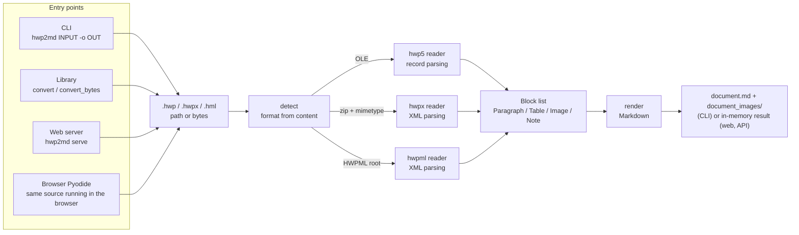

# hwp2md
[](https://pypi.org/project/hwp2markdown/)
[](https://pypi.org/project/hwp2markdown/)
[](https://github.com/ilyos-numon/hwp2md/actions/workflows/ci.yml)
[](https://pepy.tech/projects/hwp2markdown)
[](https://pepy.tech/projects/hwp2markdown)
[](https://github.com/ilyos-numon/hwp2md/stargazers)
[](https://github.com/ilyos-numon/hwp2md/blob/main/LICENSE)

**한국어:** [README.md](https://github.com/ilyos-numon/hwp2md/blob/main/README.md)

**Try it in your browser → https://ilyos-numon.github.io/hwp2md/** (no install, your file never leaves the browser, first load takes about a minute)

A pure-Python CLI, library and local web preview that converts HWP, HWPX and HWPML documents to Markdown without Hancom Office, keeping headings, tables, images, footnotes and equations.

This product was developed with reference to the HWP (.hwp) document file format specification published by Hancom Inc. (본 제품은 한글과컴퓨터의 한/글 문서 파일(.hwp) 공개 문서를 참고하여 개발하였습니다.)


> The document on screen is a fictional notice generated in code for the demo. It has nothing to do with any real organization or document.

## 30-second demo

- One line, no install: `uvx --from hwp2markdown hwp2md document.hwp -o out/` (requires [uv](https://docs.astral.sh/uv/))
- Without installing: open https://ilyos-numon.github.io/hwp2md/, click "Open converter", and drop an HWP or HWPX file.
- With pip:

```bash
pip install hwp2markdown
hwp2md document.hwp -o out/
```

## Why

Korean public-sector and corporate documents are locked inside HWP files. In the age of LLMs, the first thing you need is a key to open them.

- HWP/HWPX cannot be used directly in RAG pipelines, as LLM input, or under version control.
- Existing converters lose table and image positions, or require Hancom Office to be installed.
- Developers keep rewriting the same parsing code.

hwp2md solves this as follows.

- Pure Python that works without Hancom Office (two dependencies: `olefile` and `lxml`).
- Tables become Markdown tables; images are extracted to files and linked by relative path.
- The document's heading hierarchy (outline levels) is kept as `#` headings, which makes chunking easier.
- The CLI, the library and the web preview share one engine. Their output is byte-for-byte identical.

## Quick start

### Install

#### Without Python: Homebrew or a single executable

On macOS and Linux with Homebrew, install in one line:

```bash
brew install ilyos-numon/tap/hwp2md
hwp2md --version
```

Or download one executable for your OS. Each is a single uncompressed file that needs no Python. The links always point to the latest release.

| OS | Executable |
|----|------------|
| Windows x64 | [hwp2md-windows-x64.exe](https://github.com/ilyos-numon/hwp2md/releases/latest/download/hwp2md-windows-x64.exe) |
| macOS Apple Silicon (arm64) | [hwp2md-macos-arm64](https://github.com/ilyos-numon/hwp2md/releases/latest/download/hwp2md-macos-arm64) |
| macOS Intel (x64) | [hwp2md-macos-x64](https://github.com/ilyos-numon/hwp2md/releases/latest/download/hwp2md-macos-x64) |
| Linux x64 | [hwp2md-linux-x64](https://github.com/ilyos-numon/hwp2md/releases/latest/download/hwp2md-linux-x64) |

On macOS and Linux, make the file executable. The macOS executables are not signed or notarized, so Gatekeeper blocks a file downloaded with a browser until you remove the quarantine attribute.

```bash
chmod +x hwp2md-macos-arm64
xattr -d com.apple.quarantine hwp2md-macos-arm64   # macOS only
./hwp2md-macos-arm64 document.hwp -o out/
./hwp2md-macos-arm64 serve                         # web preview
```

On Windows, if SmartScreen shows a warning, click "More info → Run anyway". Run it from Command Prompt or PowerShell, e.g. `hwp2md-windows-x64.exe document.hwp -o out/`.

You can verify a download against [SHA256SUMS](https://github.com/ilyos-numon/hwp2md/releases/latest/download/SHA256SUMS) from the same release.

```bash
shasum -a 256 -c SHA256SUMS --ignore-missing      # macOS and Linux (sha256sum -c also works on Linux)
```

```powershell
Get-FileHash .\hwp2md-windows-x64.exe -Algorithm SHA256   # compare Hash with the value in SHA256SUMS
```

On first run the executable unpacks itself into a temporary folder, which takes a few seconds.

#### With Python

To run it in one line without installing, use `uvx --from hwp2markdown hwp2md document.hwp -o out/`. This requires [uv](https://docs.astral.sh/uv/).

The PyPI distribution name is `hwp2markdown`. After installation, the command and the import name are `hwp2md`. Python 3.11 or later is required.

```bash
pip install 'hwp2markdown[web]'          # or: uv tool install 'hwp2markdown[web]'
hwp2md --version
```

`hwp2md` on PyPI is a different project unrelated to this repository. Install `hwp2markdown`.

The web preview dependencies (Starlette, uvicorn) live only in the `web` extra. The base install (`pip install hwp2markdown`, CLI and library) uses only `olefile` and `lxml`. Running `hwp2md serve` without the extra prints a `pip install 'hwp2markdown[web]'` hint and exits with code 1.

Install from source (for development):

```bash
git clone https://github.com/ilyos-numon/hwp2md.git && cd hwp2md

# Option 1: uv (also installs the web preview and test tools)
uv sync
uv run hwp2md --version

# Option 2: pip (drop '[web]' if you do not need the web preview)
pip install '.[web]'
hwp2md --version
```

The examples below omit `uv run`. If you installed from source with uv, prefix commands with `uv run`.

### ① CLI

```text
usage: hwp2md [-h] [-o OUT_DIR] [--version] INPUT
usage: hwp2md serve [-h] [--host HOST] [--port PORT] [--no-browser]
```

This is the actual output for a synthetic demo document (5 headings, 5 body paragraphs, 1 table, 1 image). The CLI summary line is printed in Korean.

```console
$ hwp2md demo.hwpx -o out/
✓ demo.hwpx → out/demo.md
  단락 5개 · 표 1개 · 제목 5개 · 이미지 1개
  이미지: out/demo_images/ (1 files)
```

```text
out/
├── demo.md
└── demo_images/
    └── img_001.png
```

`out/demo.md` (the demo document is in Korean):

```markdown
# 2026년도 가상 문서 디지털 전환 지원사업 공고

이 문서는 hwp2md 시연을 위해 만든 가상의 공고문입니다. 실제 기관·사업과 관계없습니다.

## 1. 사업 개요

종이와 한글 문서로 관리하던 업무 자료를 검색 가능한 형태로 바꾸는 기관을 지원합니다.

| 구분 | 내용 |
|---|---|
| 지원 규모 | 총 10억 원 (기관당 최대 5천만 원) |
| 지원 기간 | 2026. 3. ~ 2026. 12. |
| 신청 방법 | 온라인 접수 (붙임 서식 작성 후 제출) |

## 2. 추진 절차

신청서 접수 후 서면 심사를 거쳐 지원 대상을 선정합니다.


### 2.1 심사 기준

사업 필요성, 추진 계획의 구체성, 성과 활용 방안을 평가합니다.

## 3. 문의

문의는 가상 사업 운영 사무국으로 해 주십시오.
```

- Without `-o`, output goes to the current folder. The output folder is created if it does not exist.
- HWP 5.0, HWPX and HWPML use the same command. The format is detected from the file contents, not the extension.
- Documents without images get no `_images` folder, and the summary line omits heading and image counts that are zero.
- Exit codes: 0 success · 1 conversion error · 2 file not found · 3 not an HWP file or an unsupported document (DRM, password protection, etc.). Error lines state the reason, such as `unsupported HWP file (DRM protected): …` or `unsupported HWP file (password protected): …`.
- If some elements could not be converted, a final line such as `  건너뜀: 머리말·꼬리말 2개 · 메모 1개` ("skipped: 2 headers/footers · 1 memo") is printed (see "Skipped-element report" below).
- If the file to convert is literally named `serve`, pass it as a path: `hwp2md ./serve`.

### ② Web preview

```bash
hwp2md serve                       # http://localhost:8770 , opens your browser automatically
hwp2md serve --port 8771           # when 8770 is already in use
hwp2md serve --no-browser          # do not open a browser
```

`/` is the converter and `/about` is the overview page (features, use cases, extraction limits at `/about#limits`). Both pages are available in Korean and English: the language follows your browser, the KO/EN button in the header switches it, and `?lang=ko` or `?lang=en` forces one. The fonts, GSAP and marked used by both pages ship inside the package, so server mode works without internet access.

1. Drop an HWP or HWPX file, or click to choose one (max 50MB).
2. The rendered preview appears on the left and the Markdown source on the right.
3. "Download ZIP" gives you the `.md` file and the image folder in one archive.

The "Process in the browser only" switch at the top right chooses where conversion happens.

| | Server mode (default) | Process in the browser only |
|---|---|---|
| Where it converts | The local `hwp2md serve` process (in memory) | Pyodide (WebAssembly Python) inside the browser |
| File bytes sent | `POST /api/convert` to the local server | None |
| Time to first conversion | Immediate | About 1 minute on first load (Pyodide and lxml download, measured about 65 s) |
| Internet | Not needed (page assets bundled) | Needed (Pyodide comes from the jsDelivr CDN) |
| Result | Same Markdown | Same Markdown (compared byte for byte in E2E tests) |


### ③ Library

Write to files (`convert`):

```python
from hwp2md import convert

result = convert("input.hwp", "out/")       # out/input.md (+ out/input_images/)
print(result.output)                         # Path("out/input.md")
print(result.heading_count, result.table_count, result.image_count)
print(result.markdown)                       # same content as the written file
```

Convert in memory only (`convert_bytes`, writes nothing to disk):

```python
from pathlib import Path
from hwp2md import convert_bytes

data = Path("input.hwp").read_bytes()
result = convert_bytes(data, filename="input.hwp")  # filename is only used for the image folder name
print(result.markdown)                     # byte-identical to the .md written by convert()
for img in result.images:                  # extracted images (unique files only)
    print(img.file_name, img.mime, len(img.data))
```

- Signatures: `convert(path: str | Path, out_dir: str | Path = ".") -> ConvertResult`, `convert_bytes(data: bytes, filename: str = "document.hwp") -> MemoryResult`.
- Exceptions: `NotHwpFileError` (not HWP), `UnsupportedHwpError` (unsupported document) and its subclasses `DrmProtectedError` (DRM-protected document) and `EncryptedDocumentError` (password-protected document), all subclasses of `Hwp2mdError`.
- Skipped elements: `result.skipped` is a tuple of (kind, count) pairs such as `(("header_footer", 2), …)` (kinds with zero are omitted). Both `convert` and `convert_bytes` results have it. `convert` raises `FileNotFoundError` for a missing file; `convert_bytes` also rejects empty input and input over 50MB with `Hwp2mdError` subclasses.

## Supported features

| Status | Item | Details |
|---|---|---|
| Supported | Formats | HWP 5.0 binary (OLE), HWPX (zip/XML), HWPML 2.x (single XML). Detected by content, not extension |
| Supported | Body paragraphs | Tabs become spaces, line breaks are kept |
| Supported | Heading hierarchy | Paragraph outline levels 1–6 → `#`–`######`, level 7 → `######` |
| Supported | Tables | GFM tables (first row is the header), multiple paragraphs in a cell joined with `<br>`, `\|` escaped, nested tables flattened to cell text |
| Supported | Images | Body images extracted to `<name>_images/img_001.png` … (original bytes) with an image link (`![그림 N]` form) in place. An image referenced again is stored once |
| Supported | Images in table cells | Image link (`![그림 N]` form) inside the cell, numbered in document order |
| Supported | Captions | Table and image captions emitted as a paragraph after the object |
| Supported | Text boxes, shapes, groups | Inner text and images emitted at the object's position |
| Supported | Hyperlinks | `[text](https://…)` form. Only http, https and mailto become links; other targets keep the text only |
| Supported | Footnotes and endnotes | `[^1]` and `[^e1]` references in the body, definitions at the end of the document |
| Supported | Equations | Hangul equation script → LaTeX `$…$` (`$$…$$` when the paragraph holds only the equation). On failure, the original script as a code span |
| Supported | Numbered and bulleted lists | Bullets become `-`, `1.` and `1)` numbering uses Markdown list syntax, other numbering (`가.`, `①`, etc.) becomes leading text. Numbers are approximated from the numbering definitions |
| Supported | OOXML charts | A `차트: <title>` ("Chart: <title>") paragraph plus a table built from the values stored in the chart |
| Supported | Distribution documents | Decrypted with the published procedure and converted (see "Distribution document notice" below) |
| Partial | OLE objects | Extracted as an image if the source is an image (PNG, JPEG, GIF, BMP); otherwise reported as skipped |
| Limited | Merged cells | Text in the origin cell, covered cells left empty (GFM cannot express merges) |
| Excluded | Headers and footers | Kept out of the body flow (to avoid chunking noise) and reported as skipped. Same for all three formats |
| Excluded | Memos and hidden comments | May contain author information, so only the count is reported, not the content |
| Limited | Formatting | Fonts, colors and alignment are dropped (see "Out of scope") |
| Rejected | DRM-protected documents | `DrmProtectedError`, CLI exit code 3, API error code `drm` |
| Rejected | Password-protected documents | `EncryptedDocumentError`, CLI exit code 3, API error code `encrypted`. There is no password input |
| Unsupported | HWP 3.0 and earlier | Detected as not an HWP file (exit code 3) |

Per-element status (extracted, partial, impossible, excluded), reasons and alternatives are in [docs/extraction-limits.md](https://github.com/ilyos-numon/hwp2md/blob/main/docs/extraction-limits.md) (Korean).

### Skipped-element report

Elements that could not be converted are not silently dropped; their counts are reported by kind. There are nine kinds: headers/footers, memos, hidden comments, charts whose data cannot be extracted, OLE objects, text art, form objects, externally linked images, and images without a body.

| Where | Shape |
|---|---|
| CLI | Last summary line `  건너뜀: 머리말·꼬리말 2개 · OLE 개체 1개` |
| Library | `ConvertResult.skipped` and `MemoryResult.skipped` tuples of (kind, count) |
| Web API | `skipped` in the response JSON: `[{"kind": "header_footer", "label": "머리말·꼬리말", "count": 2}]` (always present, empty array if none) |
| Web page | A "Not converted: …" warning above the preview (the element labels stay in Korean) |

### Distribution document notice

Distribution documents (HWP 5.0 documents distributed with editing, copying and printing restricted) are converted by default. Because this extracts text from documents restricted against editing and copying, please check the author's intent and your rights of use. hwp2md uses only the published decryption procedure and rejects DRM-protected and password-protected documents without unlocking them.

## Architecture



The three format readers return the same block model, and the renderer does not know the format. That is why the CLI, the web server and browser mode produce the same Markdown. Module roles, web endpoints, the browser-mode sequence and how to extend it are in [docs/system-overview.md](https://github.com/ilyos-numon/hwp2md/blob/main/docs/system-overview.md) (Korean).

## Privacy and security design

- **Uploads are never written to disk.** The web server converts the request body in memory (`convert_bytes`) and creates no temporary files. The E2E test `test_no_files_written` checks that the server's working folder and temp folder are empty after convert, zip and error requests.
- **Browser mode does not send file bytes to a server.** The only network requests are the Pyodide and lxml downloads (jsDelivr CDN) and the hwp2md source zip (`GET /pkg/hwp2md.zip`). The E2E test `test_browser_mode_sends_no_file` checks that there are zero non-GET requests and zero `/api/` requests during conversion.
- **XSS protection in the preview.** Document content is treated as untrusted input. The preview renderer keeps only the `<br>` used for line breaks in table cells and escapes all other raw HTML. Link targets are limited to http, https, mailto and relative paths; image sources to relative paths and `data:image/*;base64`.
- **XML and zip protection.** HWPX XML is read with a parser that disables external entities and network access, and sections over 50MB are rejected. Web input is capped at 50MB; if `Content-Length` exceeds it, the request is rejected with 413 before the body is read.
- **It is a local tool.** The default bind address is `localhost` and there is no authentication. `--host` can expose it, but it is not designed for public hosting.

## Quality and tests

| Kind | Location | Count | What it checks |
|---|---|---|---|
| Unit | `tests/unit` | 813 passed (`uv run pytest tests/unit -q`, run on 2026-10-23) | Record and XML parsers, heading detection, table assembly, image extraction, renderer, format detection, in-memory API, web app (TestClient) |
| E2E | `tests/e2e` | 120 passed (`uv run pytest tests/e2e -q`, run on 2026-10-23, including 18 per-element tests on real samples) | Real console script runs, real server + Playwright (Chromium) pages |

Key things the E2E tests verify:
- Server mode, browser mode and the CLI produce the same Markdown (`test_modes_produce_identical_markdown`, `test_convert_matches_cli`).
- The zip download matches the CLI output.
- In browser mode the file never goes to a server; in server mode uploads do not remain on disk.
- Invalid input (not HWP, empty file, over 50MB) is rejected by the API with 415, 400 and 413 respectively, and the error message for a non-HWP file is the same in both modes.
- Hints and exit codes for a port conflict and a missing web extra.

Test documents are generated in code from the specification by `tests/synth_hwp5.py` and `tests/synth_hwpx.py` (headings, tables, merged cells, images, encryption flags and other variants controlled byte by byte). Real public samples are not in the repository because their licenses have not been checked; if you put them in `tests/fixtures/`, the E2E tests pick them up automatically.

Development commands:

```bash
uv sync && uv run playwright install chromium   # development environment (including the browser for E2E)
uv run pytest tests/unit -q                     # unit
uv run pytest tests/e2e -q                      # E2E (browser-mode cases need internet)
uv run ruff check src tests && uv run ruff format --check src tests
uv run mypy src                                 # strict
```

## Limitations and known issues

- Browser mode takes about a minute on first load and needs internet access (jsDelivr). There is no offline bundle.
- The conversion quality comparison on 20 public-sector samples has not been written yet.
- CI runs on Python 3.11 and 3.13. On 3.14 there is a known difference in the error message for corrupted zip files.
- If the default port 8770 clashes with another program, change it with `--port` (it does not search for the next free port).
- There is no real HWP 5.0 sample with images, so the HWP 5.0 image path is verified only with synthetic documents and cross-checks against the published specification.
- Image formats are not converted. Originals such as WMF/EMF are saved as is and may not display in browsers.
- Legacy charts (whose values are not stored as OOXML) cannot be extracted and are reported as skipped.
- Field values such as page numbers and dates are not recalculated. List numbers are approximations.
- The position of an image placed in the middle of a paragraph can differ between HWP 5.0 and HWPX.
- The full per-element list with alternatives is in [docs/extraction-limits.md](https://github.com/ilyos-numon/hwp2md/blob/main/docs/extraction-limits.md) (Korean).

## Roadmap

- [x] Footnotes and endnotes → Markdown references at the bottom (`[^1]`)
- [ ] RAG options: `--split section` (split by heading), `--meta` (JSON with table of contents, table count, image paths, source hash)
- [ ] Batch conversion of folders
- [x] Distribution document support
- [ ] Better merged cells (`--table html` to keep rowspan/colspan)
- [ ] Quality comparison on 20 public-sector samples
- [x] PyPI release (hwp2markdown) + GitHub Actions CI

## Documentation

The documents below are written in Korean.

- [docs/vision.md](https://github.com/ilyos-numon/hwp2md/blob/main/docs/vision.md) — the finished picture (user scenarios)
- [docs/system-overview.md](https://github.com/ilyos-numon/hwp2md/blob/main/docs/system-overview.md) — internals (modules, data flow, web, security, tests, extension)
- [docs/decisions.md](https://github.com/ilyos-numon/hwp2md/blob/main/docs/decisions.md) — decision log (dates and reasons)
- [docs/releasing.md](https://github.com/ilyos-numon/hwp2md/blob/main/docs/releasing.md) — release procedure (PyPI publishing setup, tags, failure handling)
- [docs/extraction-limits.md](https://github.com/ilyos-numon/hwp2md/blob/main/docs/extraction-limits.md) — extraction limits (status, reason and alternative per element)

## Out of scope

- Reverse conversion (md → hwp)
- Faithful reproduction of formatting (fonts, colors)

## 한국어

이 문서는 영어판이다. 한국어 설명은 [README.md](https://github.com/ilyos-numon/hwp2md/blob/main/README.md) 에 있다.

## License

- hwp2md is distributed under the [MIT License](https://github.com/ilyos-numon/hwp2md/blob/main/LICENSE).
- `src/hwp2md/equation/eqedit.py` and `tokens.py` are code taken from python-hwpx and follow the Apache License 2.0. The source, commit and modifications are recorded in [NOTICE](https://github.com/ilyos-numon/hwp2md/blob/main/NOTICE).
- This product was developed with reference to the HWP (.hwp) document file format specification published by Hancom Inc. (본 제품은 한글과컴퓨터의 한/글 문서 파일(.hwp) 공개 문서를 참고하여 개발하였습니다.)
