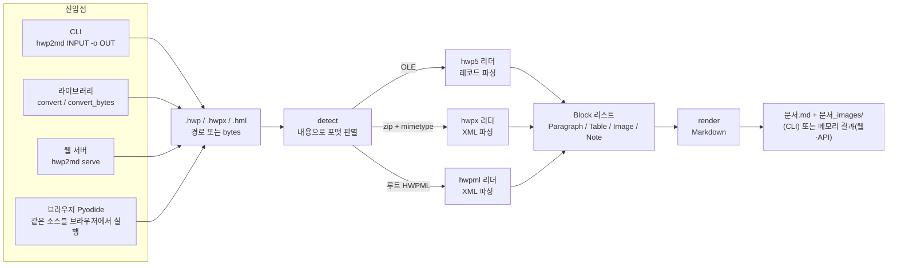

# hwp2md
[](https://pypi.org/project/hwp2markdown/)
[](https://pypi.org/project/hwp2markdown/)
[](https://github.com/ilyos-numon/hwp2md/actions/workflows/ci.yml)
[](https://pepy.tech/projects/hwp2markdown)
[](https://pepy.tech/projects/hwp2markdown)
[](https://github.com/ilyos-numon/hwp2md/stargazers)
[](https://github.com/ilyos-numon/hwp2md/blob/main/LICENSE)
**English:** [README.en.md](https://github.com/ilyos-numon/hwp2md/blob/main/README.en.md)

**브라우저에서 바로 써 보기 → https://ilyos-numon.github.io/hwp2md/** (설치 없음, 파일은 브라우저 밖으로 나가지 않음, 첫 준비 약 1분)

한컴오피스 없이 HWP·HWPX·HWPML 문서를 제목 구조·표·이미지·각주·수식이 살아 있는 Markdown 으로 바꾸는 순수 파이썬 CLI·라이브러리·로컬 웹 미리보기.

본 제품은 한글과컴퓨터의 한/글 문서 파일(.hwp) 공개 문서를 참고하여 개발하였습니다.


> 화면의 문서는 시연용으로 코드에서 만든 가상의 공고문이다. 실제 기관·문서와 관계없다.

## 30초 데모

- 설치 없이 한 줄로 실행: `uvx --from hwp2markdown hwp2md 문서.hwp -o out/` ([uv](https://docs.astral.sh/uv/) 필요)
- 설치 없이: https://ilyos-numon.github.io/hwp2md/ 에서 "변환 도구 열기" 를 누르고 HWP·HWPX 파일을 끌어다 놓는다.
- 설치해서:

```bash
pip install hwp2markdown
hwp2md 문서.hwp -o out/
```

## 왜 필요한가

한국의 공공·기업 문서는 HWP 안에 갇혀 있다. LLM 시대에 가장 먼저 필요한 건 그 문을 여는 열쇠다.

- HWP/HWPX 는 RAG 파이프라인, LLM 입력, 버전 관리 어디에도 바로 쓸 수 없다.
- 기존 변환 도구는 표·이미지 위치를 잃거나, 한컴 설치를 요구한다.
- 개발자들이 매번 같은 파싱 코드를 다시 짠다.

hwp2md 는 이 문제를 이렇게 푼다.

- 한컴 없이 동작하는 순수 파이썬 (의존성 `olefile`, `lxml` 두 개).
- 표는 Markdown 표로, 이미지는 파일로 추출해 상대 경로로 링크한다.
- 문서의 제목 계층(개요 수준)을 `#` 제목으로 보존해 청킹에 유리하게 만든다.
- 같은 엔진을 CLI·라이브러리·웹 미리보기가 함께 쓴다. 세 곳의 출력은 바이트 단위로 같다.

## 빠른 시작

### 설치

설치 없이 한 줄로 실행하려면 `uvx --from hwp2markdown hwp2md 문서.hwp -o out/` 를 쓴다. [uv](https://docs.astral.sh/uv/) 가 필요하다.

PyPI 배포 이름은 `hwp2markdown` 이다. 설치 후 명령과 import 이름은 `hwp2md` 다. Python 3.11 이상이 필요하다.

```bash
pip install 'hwp2markdown[web]'          # 또는: uv tool install 'hwp2markdown[web]'
hwp2md --version
```

PyPI 의 `hwp2md` 는 이 저장소와 무관한 다른 프로젝트다. 설치할 때는 `hwp2markdown` 을 쓴다.

웹 미리보기 의존성(Starlette·uvicorn)은 extra `web` 에만 있다. 기본 설치(`pip install hwp2markdown`, CLI·라이브러리)는 `olefile`·`lxml` 만 쓴다. extra 없이 `hwp2md serve` 를 실행하면 `pip install 'hwp2markdown[web]'` 안내와 함께 종료 코드 1로 끝난다.

소스에서 설치(개발용):

```bash
git clone https://github.com/ilyos-numon/hwp2md.git && cd hwp2md

# 방법 1: uv (웹 미리보기·테스트 도구까지 함께 설치)
uv sync
uv run hwp2md --version

# 방법 2: pip (웹 미리보기가 필요 없으면 '[web]' 을 빼도 된다)
pip install '.[web]'
hwp2md --version
```

아래 예시는 `uv run` 을 생략했다. 소스에서 uv 로 설치했다면 앞에 `uv run` 을 붙인다.

### ① CLI

```text
usage: hwp2md [-h] [-o OUT_DIR] [--version] INPUT
usage: hwp2md serve [-h] [--host HOST] [--port PORT] [--no-browser]
```

시연용 합성 문서(제목 5개·본문 5단락·표 1개·그림 1개)를 변환한 실제 출력이다.

```console
$ hwp2md demo.hwpx -o out/
✓ demo.hwpx → out/demo.md
  단락 5개 · 표 1개 · 제목 5개 · 이미지 1개
  이미지: out/demo_images/ (1 files)
```

```text
out/
├── demo.md
└── demo_images/
    └── img_001.png
```

`out/demo.md`:

```markdown
# 2026년도 가상 문서 디지털 전환 지원사업 공고

이 문서는 hwp2md 시연을 위해 만든 가상의 공고문입니다. 실제 기관·사업과 관계없습니다.

## 1. 사업 개요

종이와 한글 문서로 관리하던 업무 자료를 검색 가능한 형태로 바꾸는 기관을 지원합니다.

| 구분 | 내용 |
|---|---|
| 지원 규모 | 총 10억 원 (기관당 최대 5천만 원) |
| 지원 기간 | 2026. 3. ~ 2026. 12. |
| 신청 방법 | 온라인 접수 (붙임 서식 작성 후 제출) |

## 2. 추진 절차

신청서 접수 후 서면 심사를 거쳐 지원 대상을 선정합니다.


### 2.1 심사 기준

사업 필요성, 추진 계획의 구체성, 성과 활용 방안을 평가합니다.

## 3. 문의

문의는 가상 사업 운영 사무국으로 해 주십시오.
```

- `-o` 를 생략하면 현재 폴더에 쓴다. 출력 폴더가 없으면 만든다.
- HWP 5.0·HWPX·HWPML 은 같은 명령이다. 포맷은 확장자가 아니라 파일 내용으로 판별한다.
- 이미지가 없는 문서는 `_images` 폴더를 만들지 않고, 요약 줄에서 0개인 제목·이미지 항목을 생략한다.
- 종료 코드: 0 성공 · 1 변환 오류 · 2 파일 없음 · 3 HWP 가 아니거나 지원하지 않는 문서(DRM·비밀번호 문서 등). 오류 줄은 `unsupported HWP file (DRM protected): …`, `unsupported HWP file (password protected): …` 처럼 거부 이유를 구분한다.
- 변환하지 못한 요소가 있으면 마지막에 `  건너뜀: 머리말·꼬리말 2개 · 메모 1개` 같은 줄이 붙는다(아래 "건너뜀 보고").
- 변환할 파일 이름이 `serve` 이면 `hwp2md ./serve` 처럼 경로로 적는다.

### ② 웹 미리보기

```bash
hwp2md serve                       # http://localhost:8770 , 브라우저가 자동으로 열린다
hwp2md serve --port 8771           # 8770 이 이미 쓰이고 있을 때
hwp2md serve --no-browser          # 브라우저 자동 열기 끔
```

`/` 은 변환 화면, `/about` 은 서비스 소개(기능, 사용 장면, 추출 한계 `/about#limits`)다. 두 화면에 쓰는 글꼴·GSAP·marked 는 패키지 안에 동봉돼 있어 서버 모드는 인터넷 없이 동작한다.

1. HWP·HWPX 파일을 끌어다 놓거나 클릭해서 고른다 (최대 50MB).
2. 왼쪽에 렌더링된 미리보기, 오른쪽에 Markdown 원문이 나온다.
3. "zip 다운로드" 로 `.md` 와 이미지 폴더를 한 번에 받는다.

오른쪽 위 "브라우저 안에서만 처리" 스위치로 변환 위치를 고른다.

| | 서버 모드 (기본) | 브라우저 안에서만 처리 |
|---|---|---|
| 변환 위치 | 로컬 `hwp2md serve` 프로세스 (메모리에서 변환) | 브라우저 안의 Pyodide (WebAssembly 파이썬) |
| 파일 바이트 전송 | 로컬 서버로 `POST /api/convert` | 보내지 않음 |
| 첫 변환까지 | 즉시 | 첫 로딩 약 1분 (Pyodide·lxml 다운로드, 측정 약 65초) |
| 인터넷 | 필요 없음 (화면 자원 동봉) | 필요 (Pyodide 를 jsDelivr CDN 에서 받음) |
| 결과 | 같은 Markdown | 같은 Markdown (E2E 로 바이트 비교) |


### ③ 라이브러리

파일로 쓰기 (`convert`):

```python
from hwp2md import convert

result = convert("input.hwp", "out/")       # out/input.md (+ out/input_images/)
print(result.output)                         # Path("out/input.md")
print(result.heading_count, result.table_count, result.image_count)
print(result.markdown)                       # 파일에 쓴 것과 같은 내용
```

메모리에서만 변환하기 (`convert_bytes`, 디스크에 아무것도 쓰지 않는다):

```python
from pathlib import Path
from hwp2md import convert_bytes

data = Path("input.hwp").read_bytes()
result = convert_bytes(data, filename="input.hwp")  # filename 은 이미지 폴더 이름에만 쓰인다
print(result.markdown)                     # convert() 가 쓰는 .md 와 바이트 동일
for img in result.images:                  # 추출된 이미지 (고유 파일만)
    print(img.file_name, img.mime, len(img.data))
```

- 시그니처: `convert(path: str | Path, out_dir: str | Path = ".") -> ConvertResult`, `convert_bytes(data: bytes, filename: str = "document.hwp") -> MemoryResult`.
- 예외: `NotHwpFileError`(HWP 아님), `UnsupportedHwpError`(지원하지 않는 문서)와 그 하위 `DrmProtectedError`(DRM 적용 문서)·`EncryptedDocumentError`(비밀번호 문서), 모두 `Hwp2mdError` 하위.
- 건너뛴 요소: `result.skipped` 는 `(("header_footer", 2), …)` 처럼 종류와 개수의 튜플이다(0개는 빠진다). `convert`·`convert_bytes` 결과 모두에 있다. `convert` 는 파일이 없으면 `FileNotFoundError`, `convert_bytes` 는 빈 입력·50MB 초과도 `Hwp2mdError` 하위 예외로 거부한다.

## 지원 범위

| 구분 | 항목 | 설명 |
|---|---|---|
| 지원 | 포맷 | HWP 5.0 바이너리(OLE), HWPX(zip/XML), HWPML 2.x(단일 XML). 확장자가 아니라 내용으로 판별 |
| 지원 | 본문 단락 | 탭은 공백, 줄바꿈 유지 |
| 지원 | 제목 계층 | 문단 모양의 개요 1~6수준 → `#`~`######`, 7수준은 `######` |
| 지원 | 표 | GFM 표 (첫 행이 헤더), 셀 안 여러 단락은 `<br>`, `\|` 이스케이프, 중첩 표는 셀 텍스트로 평탄화 |
| 지원 | 이미지 | 본문 그림을 `<이름>_images/img_001.png` … 로 추출(원본 바이트 그대로)하고 제자리에 그림 링크(`![그림 N]` 꼴). 같은 그림을 다시 참조하면 파일 1개 |
| 지원 | 표 칸 안 그림 | 칸 안에 그림 링크(`![그림 N]` 꼴). 문서 순서대로 그림 번호를 쓴다 |
| 지원 | 캡션 | 표·그림 캡션을 개체 뒤 단락으로 출력 |
| 지원 | 글상자·도형·묶음 | 안쪽 글과 그림을 개체 자리에 출력 |
| 지원 | 하이퍼링크 | `[글자](https://…)` 꼴. http·https·mailto 만 링크로 쓰고 그 밖의 주소는 글자만 남긴다 |
| 지원 | 각주·미주 | 본문에 `[^1]`·`[^e1]` 참조, 문서 끝에 정의 |
| 지원 | 수식 | 한글 수식 스크립트 → LaTeX `$…$` (단락에 수식만 있으면 `$$…$$`). 변환에 실패하면 원문 스크립트를 코드 스팬으로 |
| 지원 | 번호·글머리표 목록 | 글머리표는 `-`, `1.`·`1)` 꼴 번호는 Markdown 목록 문법, 그 밖의 번호(`가.`·`①` 등)는 단락 앞 글자로. 번호는 문단 번호 정의로 근사 계산 |
| 지원 | OOXML 차트 | 차트에 저장된 값으로 `차트: 제목` 단락 + 표 |
| 지원 | 배포용 문서 | 공개된 절차로 복호화해 변환 (아래 "배포용 문서 고지") |
| 부분 | OLE 개체 | 원본이 그림(PNG·JPEG·GIF·BMP)이면 그림으로 추출, 그 밖은 건너뜀 보고 |
| 제한 | 병합 셀 | 원 셀에 텍스트, 덮인 칸은 빈 칸 (GFM 이 병합을 표현하지 못함) |
| 제외 | 머리말·꼬리말 | 본문 흐름에 넣지 않고(청킹 잡음 방지) 건너뜀으로 보고. 세 포맷 동일 |
| 제외 | 메모·숨은 설명 | 작성자 정보가 있을 수 있어 내용은 출력하지 않고 개수만 보고 |
| 제한 | 서식 | 글꼴·색상·정렬은 버린다 ("하지 않는 것" 참조) |
| 거부 | DRM 적용 문서 | `DrmProtectedError`, CLI 종료 코드 3, API 오류 코드 `drm` |
| 거부 | 비밀번호 문서 | `EncryptedDocumentError`, CLI 종료 코드 3, API 오류 코드 `encrypted`. 비밀번호 입력 기능은 없다 |
| 미지원 | HWP 3.0 이하 | HWP 파일이 아닌 것으로 판정 (종료 코드 3) |

요소별 상태(추출·부분·불가·제외)와 이유, 대안은 [docs/extraction-limits.md](https://github.com/ilyos-numon/hwp2md/blob/main/docs/extraction-limits.md) 에 있다.

### 건너뜀 보고

변환하지 못한 요소는 조용히 버리지 않고 종류별 개수를 알려 준다. 종류는 머리말·꼬리말, 메모, 숨은 설명, 데이터를 꺼낼 수 없는 차트, OLE 개체, 글맵시, 양식 개체, 외부 연결 그림, 본체 없는 그림 아홉 가지다.

| 어디서 | 모양 |
|---|---|
| CLI | 요약 끝 줄 `  건너뜀: 머리말·꼬리말 2개 · OLE 개체 1개` |
| 라이브러리 | `ConvertResult.skipped`·`MemoryResult.skipped` (종류, 개수) 튜플 |
| 웹 API | 응답 JSON 의 `skipped`: `[{"kind": "header_footer", "label": "머리말·꼬리말", "count": 2}]` (항상 있음, 없으면 빈 배열) |
| 웹 화면 | 미리보기 위 "변환하지 못한 요소: …" 경고 |

### 배포용 문서 고지

배포용 문서(편집·복사·인쇄를 제한해 배포한 HWP 5.0 문서)는 기본으로 변환한다. 편집·복사 제한 문서를 텍스트로 꺼내므로 작성자의 의도와 사용 권한을 확인하세요. hwp2md 는 공개된 복호화 절차만 쓰며, DRM 적용 문서와 비밀번호 문서는 풀지 않고 거부한다.

## 구조



세 포맷의 리더는 같은 블록 모델을 돌려주고, 렌더러는 포맷을 모른다. 그래서 CLI·웹 서버·브라우저 모드가 같은 Markdown 을 낸다. 모듈별 역할, 웹 엔드포인트, 브라우저 모드 시퀀스, 확장 방법은 [docs/system-overview.md](https://github.com/ilyos-numon/hwp2md/blob/main/docs/system-overview.md) 에 있다.

## 개인정보·보안 설계

- **업로드는 디스크에 쓰지 않는다.** 웹 서버는 요청 본문을 메모리에서 바로 변환한다(`convert_bytes`). 임시 파일도 만들지 않는다. E2E `test_no_files_written` 이 변환·zip·오류 요청 뒤 서버의 작업 폴더와 임시 폴더가 비어 있는지 확인한다.
- **브라우저 모드는 파일 바이트를 서버로 보내지 않는다.** 네트워크 요청은 Pyodide·lxml 다운로드(jsDelivr CDN)와 hwp2md 소스 zip(`GET /pkg/hwp2md.zip`)뿐이다. E2E `test_browser_mode_sends_no_file` 이 변환 중 GET 이외 요청 0건, `/api/` 요청 0건을 확인한다.
- **미리보기 XSS 방어.** 문서 내용은 외부 입력으로 본다. 미리보기 렌더러는 원시 HTML 중 표 셀 줄바꿈용 `<br>` 만 살리고 나머지는 이스케이프한다. 링크 주소는 http·https·mailto 와 상대 경로만, 이미지 주소는 상대 경로와 `data:image/*;base64` 만 허용한다.
- **XML·zip 방어.** HWPX XML 은 외부 엔티티·네트워크를 끈 파서로 읽고, 50MB 를 넘는 섹션은 거부한다. 웹 입력은 50MB 상한이며 `Content-Length` 가 넘으면 본문을 읽기 전에 413 으로 거절한다.
- **로컬 전용 도구다.** 기본 바인드는 `localhost` 이고 인증이 없다. `--host` 로 외부에 열 수는 있지만 외부 공개용으로 설계하지 않았다.

## 품질·테스트

| 종류 | 위치 | 수 | 무엇을 보나 |
|---|---|---|---|
| 단위 | `tests/unit` | 813 passed (`uv run pytest tests/unit -q`, 2026-10-23 직접 실행) | 레코드·XML 파서, 제목 판정, 표 조립, 이미지 추출, 렌더러, 포맷 판별, 메모리 API, 웹 앱(TestClient) |
| E2E | `tests/e2e` | 120 passed (`uv run pytest tests/e2e -q`, 2026-10-23 직접 실행, 실제 샘플 요소별 18개 포함) | 실제 콘솔 스크립트 실행, 실제 서버 + Playwright(Chromium) 화면 |

E2E 가 검증하는 핵심:
- 서버 모드 · 브라우저 모드 · CLI 의 Markdown 이 같다 (`test_modes_produce_identical_markdown`, `test_convert_matches_cli`).
- zip 다운로드 내용이 CLI 출력과 같다.
- 브라우저 모드에서 파일이 서버로 가지 않는다, 서버 모드에서 업로드가 디스크에 남지 않는다.
- 잘못된 입력(HWP 아님·빈 파일·50MB 초과)은 API 가 각각 415·400·413 으로 거절하고, HWP 가 아닌 파일의 오류 문구는 두 모드에서 같다.
- 포트 충돌·web extra 미설치 시 안내와 종료 코드.

테스트 문서는 `tests/synth_hwp5.py`·`tests/synth_hwpx.py` 가 명세 기준으로 코드에서 만든다(제목·표·병합 셀·이미지·암호화 플래그 등 변형을 바이트 단위로 통제). 실제 공개 샘플은 라이선스 확인 전이라 저장소에 넣지 않았고, `tests/fixtures/` 에 넣으면 E2E 가 자동으로 함께 돌린다.

개발 명령:

```bash
uv sync && uv run playwright install chromium   # 개발 환경 (E2E 용 브라우저 포함)
uv run pytest tests/unit -q                     # 단위
uv run pytest tests/e2e -q                      # E2E (브라우저 모드 케이스는 인터넷 필요)
uv run ruff check src tests && uv run ruff format --check src tests
uv run mypy src                                 # strict
```

## 한계와 알려진 이슈

- 브라우저 모드 첫 로딩이 약 1분 걸리고 인터넷(jsDelivr)이 필요하다. 오프라인 번들은 없다.
- 공공기관 샘플 20개 변환 품질 비교표는 아직 작성하지 않았다.
- CI 는 Python 3.11·3.13 에서 검증한다. 3.14 에서는 손상된 zip 의 오류 문구가 다르게 나오는 알려진 차이가 있다.
- 기본 포트 8770 이 다른 프로그램과 겹치면 `--port` 로 바꾼다 (자동으로 다음 포트를 찾지 않는다).
- 이미지가 있는 실제 HWP 5.0 샘플이 없어, HWP 5.0 이미지 경로는 합성 문서와 공개 스펙 교차 확인으로만 검증했다.
- 이미지 포맷은 변환하지 않는다. WMF/EMF 같은 원본은 그대로 저장되어 브라우저에서 안 보일 수 있다.
- 구형 차트(차트 값이 OOXML 로 저장되지 않은 것)는 데이터를 꺼내지 못하고 건너뜀으로 보고한다.
- 쪽 번호·날짜 같은 필드 값은 다시 계산하지 않는다. 목록 번호는 근사값이다.
- 단락 중간에 놓인 그림의 위치가 HWP 5.0 과 HWPX 에서 다를 수 있다.
- 요소별 전체 목록과 대안은 [docs/extraction-limits.md](https://github.com/ilyos-numon/hwp2md/blob/main/docs/extraction-limits.md) 에 있다.

## 로드맵

- [x] 각주·미주 → Markdown 하단 참조(`[^1]`)
- [ ] RAG 옵션: `--split section` (제목 단위 분할), `--meta` (목차·표 수·이미지 경로·원본 해시 JSON)
- [ ] 폴더 일괄 변환
- [x] 배포용 문서 지원
- [ ] 병합 셀 개선 (`--table html` 로 rowspan/colspan 보존)
- [ ] 공공기관 샘플 20개 품질 비교표
- [x] PyPI 배포(hwp2markdown) + GitHub Actions CI

## 문서

- [docs/vision.md](https://github.com/ilyos-numon/hwp2md/blob/main/docs/vision.md) — 완성된 모습 (사용자 시나리오)
- [docs/system-overview.md](https://github.com/ilyos-numon/hwp2md/blob/main/docs/system-overview.md) — 내부 구조 (모듈·데이터 흐름·웹·보안·테스트·확장)
- [docs/decisions.md](https://github.com/ilyos-numon/hwp2md/blob/main/docs/decisions.md) — 결정 기록 (날짜와 이유)
- [docs/releasing.md](https://github.com/ilyos-numon/hwp2md/blob/main/docs/releasing.md) — 릴리스 절차 (PyPI 게시 설정·태그·실패 대응)
- [docs/extraction-limits.md](https://github.com/ilyos-numon/hwp2md/blob/main/docs/extraction-limits.md) — 추출 한계 (요소별 상태·이유·대안)

## 하지 않는 것

- 역변환 (md → hwp)
- 서식 완벽 재현 (글꼴·색상)

## English

hwp2md converts Korean HWP 5.0, HWPX and HWPML documents to Markdown without Hancom Office. It keeps the heading hierarchy, tables, images, footnotes and equations (as LaTeX), so the output is ready for RAG pipelines, LLM input and version control.

- Install: `pip install hwp2markdown` (Python 3.11+). The command and import name is `hwp2md`: `hwp2md input.hwp -o out/`, or `from hwp2md import convert`.
- Try it in your browser: https://ilyos-numon.github.io/hwp2md/ — no install; the converter runs in Pyodide (WebAssembly Python), and the first load takes about a minute.
- Privacy: in the browser demo your file never leaves the browser. The local web preview (`hwp2md serve`, extra `[web]`) converts uploads in memory and writes nothing to disk.
- License: MIT. The vendored equation converter is Apache-2.0 (see NOTICE). Developed with reference to Hancom's published HWP file format documents.

## 라이선스

- hwp2md 는 [MIT 라이선스](https://github.com/ilyos-numon/hwp2md/blob/main/LICENSE)로 배포한다.
- `src/hwp2md/equation/eqedit.py`·`tokens.py` 는 python-hwpx 에서 가져온 코드로 Apache License 2.0 을 따른다. 출처·커밋·변경 사실은 [NOTICE](https://github.com/ilyos-numon/hwp2md/blob/main/NOTICE) 에 있다.
- 본 제품은 한글과컴퓨터의 한/글 문서 파일(.hwp) 공개 문서를 참고하여 개발하였습니다.
