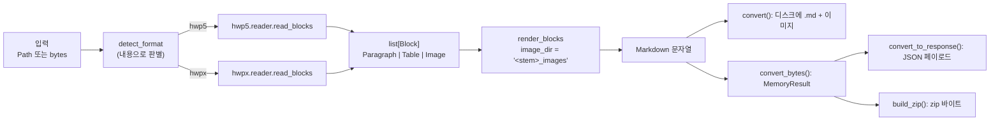
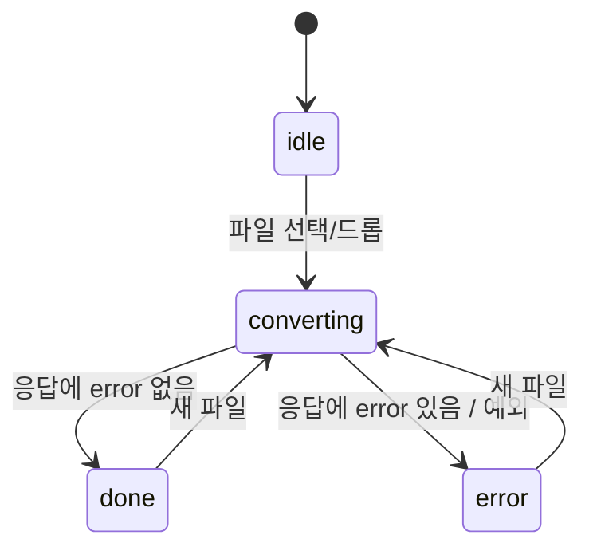
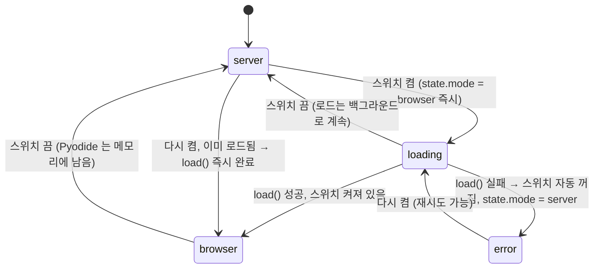

# hwp2md 기능 명세 (구현 기준)

> 이 문서는 **현재 코드가 실제로 어떻게 동작하는가**를 적는다. 기준은 `main` 브랜치 커밋 `e18cd70`, 패키지 버전 `0.1.0` 이다.
> 설계 의도는 [vision.md](vision.md), 구조 개요는 [system-overview.md](system-overview.md), 결정 이유는 [decisions.md](decisions.md) 에 있다. 이 문서와 그 문서들이 다르면 **이 문서(코드)가 맞다.** 다른 지점은 §12 에 모아 두었다.
>
> 프론트엔드를 새로 구현하는 사람을 위해 웹 API 계약(§8), 현재 UI의 상태·이벤트 모델(§9), 프론트엔드가 지켜야 할 불변식(§10)을 특히 자세히 적었다.

---

## 0. 목차

1. [기능 카테고리 지도](#1-기능-카테고리-지도)
2. [공통 변환 파이프라인](#2-공통-변환-파이프라인)
3. [A. 입력 판별](#3-a-입력-판별)
4. [B. 변환 엔진 (문서 → 블록)](#4-b-변환-엔진-문서--블록)
5. [C. Markdown 출력 규칙](#5-c-markdown-출력-규칙)
6. [D1. CLI](#6-d1-cli)
7. [D2. 라이브러리 API](#7-d2-라이브러리-api)
8. [E. 웹 HTTP API](#8-e-웹-http-api)
9. [F. 웹 UI (현재 구현)](#9-f-웹-ui-현재-구현)
10. [프론트엔드 설계 철학과 불변식](#10-프론트엔드-설계-철학과-불변식)
11. [G. 오류 체계 (전 계층 대응표)](#11-g-오류-체계-전-계층-대응표)
12. [포맷 간 차이와 문서-코드 불일치](#12-포맷-간-차이와-문서-코드-불일치)
13. [H. 보안·개인정보](#13-h-보안개인정보)
14. [한계와 범위 밖](#14-한계와-범위-밖)
15. [소스 색인](#15-소스-색인)

---

## 1. 기능 카테고리 지도

| 카테고리 | 기능 | 진입 위치 | 상태 |
|---|---|---|---|
| **A. 입력 판별** | 파일 내용으로 HWP 5.0 / HWPX 구분 (확장자 무시) | `detect.detect_format` | 구현 |
| **B. 변환 엔진** | B1 본문 단락 텍스트 | `hwp5/`, `hwpx/` | 구현 |
| | B2 제목 계층 (개요 수준 → `#`~`######`) | 〃 | 구현 |
| | B3 표 (병합 셀, 셀 내 줄바꿈, 중첩 표 평탄화) | 〃 | 구현 |
| | B4 이미지 추출 (원본 바이트, 중복 제거, 순번 이름) | 〃 | 구현 |
| | B5 다중 섹션 이어 붙이기 | 〃 | 구현 |
| | 각주·미주, 목차, 리스트, 서식 | — | 미구현 (§14) |
| **C. 출력** | C1 Markdown 문자열 렌더 | `render.render_blocks` | 구현 |
| | C2 디스크 출력 (`.md` + `_images/`) | `convert.convert` | 구현 |
| | C3 메모리 출력 (Markdown + 이미지 바이트) | `memory.convert_bytes` | 구현 |
| | C4 미리보기용 data URI Markdown | `memory.markdown_with_data_uris` | 구현 |
| | C5 zip 패키징 | `memory.build_zip` | 구현 |
| | C6 웹 응답 페이로드 / 오류 코드 | `memory.convert_to_response` | 구현 |
| **D. 진입점** | D1-a CLI 변환 `hwp2md INPUT -o OUT` | `cli.main` | 구현 |
| | D1-b CLI 웹 서버 `hwp2md serve` | `cli._serve_main` → `web/server.serve` | 구현 (`[web]` extra 필요) |
| | D2-a 라이브러리 파일 API `convert()` | `hwp2md.convert` | 구현 |
| | D2-b 라이브러리 메모리 API `convert_bytes()` | `hwp2md.convert_bytes` | 구현 |
| **E. 웹 HTTP API** | 헬스체크, 변환(JSON), zip, 정적 파일, Pyodide용 소스 zip | `web/app.py` | 구현 |
| **F. 웹 UI** | F1 파일 입력 (드롭·클릭·키보드) | `static/app.js` | 구현 |
| | F2 미리보기 / 원문 두 칸 | 〃 | 구현 |
| | F3 zip 다운로드 | 〃 | 구현 |
| | F4 모드 전환: 서버 모드 ↔ 브라우저 전용 모드(Pyodide) | `app.js` + `pyodide-runner.js` | 구현 |
| | F5 안전한 미리보기 렌더 (XSS 방어) | `app.js` marked 렌더러 | 구현 |
| | F6 오류 표시 (한국어 문구) | `app.js` | 구현 |
| **G. 오류 체계** | 예외 → CLI 종료 코드 / HTTP 상태 / UI 문구 | `errors.py`, `cli.py`, `memory.py`, `app.js` | 구현 |
| **H. 보안** | XXE·엔티티 폭발·zip 폭탄 방어, 무저장, 무전송 | 여러 곳 | 구현 |

---

## 2. 공통 변환 파이프라인

모든 진입점(CLI, 라이브러리, 웹 서버, 브라우저 모드)은 **같은 두 함수**를 거친다: `convert.read_blocks(source)` → `render.render_blocks(blocks, image_dir=...)`. 그래서 어느 경로로 변환해도 Markdown 바이트가 같다.



| 진입점 | 호출 경로 | 디스크 쓰기 |
|---|---|---|
| CLI `hwp2md INPUT` | `cli.main` → `convert()` | 함 |
| 라이브러리 `convert()` | 직접 | 함 |
| 라이브러리 `convert_bytes()` | 직접 | 안 함 |
| 웹 서버 `/api/convert`, `/api/zip` | `memory.convert_to_response` / `convert_bytes` + `build_zip` | 안 함 |
| 브라우저 모드 | Pyodide 안에서 `convert_to_response` / `build_zip` | 안 함 (서버로 전송도 안 함) |

---

## 3. A. 입력 판별

`detect_format(src: Path | bytes) -> "hwp5" | "hwpx"` ([detect.py](../src/hwp2md/detect.py))

판정 순서 (처음 맞는 규칙에서 멈춘다):

| 순서 | 조건 | 결과 |
|---|---|---|
| 1 | OLE 복합 문서 (`olefile.isOleFile`) | `"hwp5"` — FileHeader 검증은 HWP 5.0 리더가 따로 한다 |
| 2 | zip 이고, `mimetype` 엔트리가 있고, 크기 ≤ 256바이트이며 내용을 `strip()` 한 값이 `application/hwp+zip` | `"hwpx"` |
| 3 | zip 이고 `Contents/section0.xml` 엔트리가 있음 | `"hwpx"` |
| 4 | zip 이지만 위 둘 다 아님 | `NotHwpFileError("zip archive is not an HWPX package: …")` |
| 5 | zip 이 깨짐 | `NotHwpFileError("corrupt zip archive: …")` |
| 6 | 그 외 | `NotHwpFileError("not an HWP 5.0 or HWPX file: …")` |

- **확장자는 어떤 경우에도 보지 않는다.** `.hwp` 확장자에 HWPX 내용이 든 공공기관 배포 파일이 있어서다. 프론트엔드도 확장자로 거르면 안 된다(§10).
- OLE 이기만 하면 1단계에서 `hwp5` 로 판정한다. 그래서 `.doc`(OLE) 파일은 HWP 5.0 리더에서 `NotHwpFileError("FileHeader stream missing: …")` 로 실패한다.
- 오류 메시지의 위치 표시는 경로 입력이면 경로 문자열, bytes 입력이면 `<memory>` 다.
- bytes 입력은 항상 `io.BytesIO` 로 감싸서 넘긴다. olefile 은 1536바이트 미만 bytes 를 파일 경로로 해석하기 때문이다([source.py](../src/hwp2md/source.py)).

---

## 4. B. 변환 엔진 (문서 → 블록)

### 4.1 블록 모델

[blocks.py](../src/hwp2md/blocks.py). 리더는 포맷과 상관없이 다음 세 종류 블록의 리스트를 문서 순서대로 만든다.

| 블록 | 필드 | 의미 |
|---|---|---|
| `Paragraph` | `text: str`, `level: int = 0` | `level` 0 = 본문, 1~6 = Markdown 제목 수준 |
| `Table` | `rows: list[list[str]]` | 직사각형 격자. 모든 행의 칸 수가 같다. 셀 값은 문자열 (셀 안 줄바꿈은 `\n`) |
| `Image` | `file_name: str`, `data: bytes` | `img_001.png` 처럼 리더가 붙인 이름과 원본 바이트 (변환 없음) |

빈 텍스트 단락은 리더가 블록으로 만들지 않는다.

### 4.2 HWP 5.0 읽기

[hwp5/reader.py](../src/hwp2md/hwp5/reader.py), [records.py](../src/hwp2md/hwp5/records.py), [docinfo.py](../src/hwp2md/hwp5/docinfo.py), [body.py](../src/hwp2md/hwp5/body.py)

**컨테이너 검사 순서**

1. OLE 가 아니면 `NotHwpFileError("not an OLE compound file: …")`.
2. `FileHeader` 스트림이 없으면 `NotHwpFileError("FileHeader stream missing: …")`.
3. FileHeader 가 256바이트가 아니거나 앞 32바이트가 `"HWP Document File" + NUL×15` 가 아니면 `NotHwpFileError`.
4. 속성 비트 1(암호화) → `UnsupportedHwpError("encrypted document: …")`, 비트 2(배포용) → `UnsupportedHwpError("distribution document: …")`.
5. 속성 비트 0(압축)이 켜져 있으면 `DocInfo` 와 `BodyText/Section<N>` 을 raw deflate(`zlib wbits=-15`)로 푼다.
6. `BodyText/Section0`, `Section1`, … 을 번호가 끊길 때까지 읽는다. 하나도 없으면 `NotHwpFileError("BodyText/Section0 stream missing: …")`.
7. `BinData/*` 스트림은 원본 바이트 그대로 모아 둔다 (이미지 해석 때 개별적으로 푼다).

**레코드 파싱**: 헤더 UINT32 LE 에서 `tag = v & 0x3FF`, `level = (v>>10) & 0x3FF`, `size = (v>>20) & 0xFFF`. `size == 0xFFF` 이면 다음 UINT32 가 실제 크기. 헤더나 본문이 잘리면 `Hwp2mdError("truncated record at offset N")`.

**단락 텍스트 디코딩** (`PARA_TEXT`, UTF-16LE). 결과는 앞뒤 공백을 `strip()` 한다.

| 문자 코드 | 처리 |
|---|---|
| ≥ 32 | 그대로 |
| 9 (탭) | 공백 1개, 8 WCHAR 건너뜀 |
| 1~8, 11, 12, 14~23 (확장·인라인 컨트롤: 표·그림 위치 표시 등) | 출력 없음, 8 WCHAR 건너뜀 |
| 10 (줄바꿈) | `\n` |
| 13 (단락 끝) | 여기서 끝 |
| 24 (하이픈) | `-` |
| 30, 31 (묶음·고정폭 빈칸) | 공백 |
| 0, 25~29 | 출력 없음 |

**구조 조립** (레코드 `level` 트리 순회):

- 최상위(level 0) `PARA_HEADER` 하나 = 단락 하나. 단락 안의 텍스트는 `Paragraph` 로, 단락에 딸린 컨트롤은 **단락 텍스트 뒤에** 블록으로 붙는다(§12-1 참고).
- `CTRL_HEADER` 의 컨트롤 ID 가 `tbl ` → 표 (§4.5).
- 컨트롤 ID 가 `gso ` → 그리기 개체. 그 하위 트리 전체에서 `SHAPE_COMPONENT_PICTURE`(0x55) 레코드를 순서대로 찾아 이미지로 만든다. 그리기 개체 안의 **텍스트(글상자 내용)는 버린다.**
- 그 밖의 컨트롤(머리말·꼬리말·각주 등) → 안쪽 단락을 **본문 단락으로 흘려보낸다.** 그래서 머리말·각주 텍스트가 본문에 섞일 수 있다(§12).

### 4.3 HWPX 읽기

[hwpx/reader.py](../src/hwp2md/hwpx/reader.py), [header.py](../src/hwp2md/hwpx/header.py), [bindata.py](../src/hwp2md/hwpx/bindata.py), [body.py](../src/hwp2md/hwpx/body.py)

**패키지 읽기**

- 섹션: `Contents/section<N>.xml` 을 **N 숫자 오름차순**으로 읽는다(`section10` 이 `section2` 뒤). `section0.xml` 이 없으면 `NotHwpFileError`.
- `Contents/header.xml` (선택): 제목 수준 표. 없으면 제목 없음으로 처리. 있는데 XML 이 깨졌거나 루트가 `hh:head` 가 아니면 `Hwp2mdError`.
- `Contents/content.hpf` (선택): 이미지 매니페스트. 깨졌으면 **조용히 빈 매니페스트**로 처리.
- `BinData/` 로 시작하는 모든 파일 엔트리.
- 크기 상한: 섹션·header·manifest 엔트리 각 50MB, BinData 엔트리 각 50MB. 넘으면 `Hwp2mdError("… too large …")`.
- 섹션 XML 이 깨졌으면 `Hwp2mdError("malformed section XML: …")`, 루트가 `hs:sec` 가 아니면 `Hwp2mdError("unexpected root element: …")`.
- HWPX 에는 암호화·배포용 검사가 없다.

**단락 처리** (`hp:sec` 의 직계 `hp:p` 만, 순서대로)

`hp:p` → 직계 `hp:run` 들 → 각 run 의 직계 자식을 순서대로 본다.

| 요소 | 처리 |
|---|---|
| `hp:t` | 텍스트를 버퍼에 이어 붙인다. 안쪽 인라인 요소는 아래 표 |
| `hp:tbl` | 버퍼를 단락으로 내보낸(flush) 뒤 표 블록 |
| `hp:pic` | 버퍼를 flush 한 뒤 이미지 블록 (`hc:img/@binaryItemIDRef`) |
| `hp:container` | 안의 모든 `hp:pic` 을 이미지로 (묶음 개체) |
| 그 밖 (`hp:secPr`, `hp:ctrl` = 머리말·꼬리말·쪽번호·각주, `hp:rect` 등 도형·글상자) | **무시** (텍스트도 그림도 출력 안 함) |

flush 는 버퍼를 `strip()` 해서 비어 있지 않을 때만 `Paragraph` 를 만든다. 그래서 **HWPX 는 한 단락 안에 그림·표가 끼어 있으면 그 앞뒤 텍스트가 별도 단락으로 나뉜다.** 나뉜 조각들은 모두 같은 제목 수준을 갖는다.

`hp:t` 안 인라인 요소:

| 요소 | 텍스트 |
|---|---|
| `hp:tab` | 공백 |
| `hp:lineBreak` | `\n` |
| `hp:nbSpace`, `hp:fwSpace` | 공백 |
| `hp:hypen` (OWPML 철자) | `-` |
| 그 밖 | 빈 문자열 (뒤따르는 텍스트는 유지) |

### 4.4 B2. 제목 판정

두 포맷 모두 **문단 모양의 개요(OUTLINE) 속성만** 본다. 스타일 이름("개요 1" 등)은 보지 않는다.

| | HWP 5.0 | HWPX |
|---|---|---|
| 단락 → 문단 모양 | `PARA_HEADER` 오프셋 8 의 UINT16 `para_shape_id` (payload 10바이트 미만이면 본문) | `hp:p/@paraPrIDRef` |
| 문단 모양 목록 | `DocInfo` 의 `PARA_SHAPE`(0x19) 레코드, 등장 순서 = ID (0부터) | `header.xml` 의 `hh:paraPr[@id]` |
| 개요 여부 | 속성1 비트 23~24 == 1 | 첫 `hh:heading` 의 `@type == "OUTLINE"` (`hp:switch/hp:case` 안 포함) |
| 개요 수준 | 속성1 비트 25~27 (0~7) | `hh:heading/@level` |

- Markdown 제목 수준 = `min(개요 수준 + 1, 6)`. 개요 7수준 이상은 `######` 로 묶인다.
- 번호·글머리표 머리 모양은 제목이 아니라 본문이다.
- **표 셀 안 단락의 제목 수준은 버린다** (셀 텍스트로만 쓴다).

### 4.5 B3. 표

**HWP 5.0**: `CTRL_HEADER(tbl)` → `TABLE`(오프셋 4 에서 행 수·열 수 UINT16) → 셀마다 `LIST_HEADER`(오프셋 8 에서 열·행·열 병합·행 병합 UINT16) → 셀 단락들.
**HWPX**: `hp:tbl/@rowCnt`, `@colCnt` (없으면 `hp:tr` 개수 / 가장 긴 행의 `hp:tc` 개수). 셀 위치 `hp:cellAddr/@rowAddr,@colAddr`, 병합 `hp:cellSpan/@rowSpan,@colSpan`. 셀 텍스트는 `hp:subList` 의 `hp:p` 들.

공통 배치 규칙 (`_place_cells`, 두 포맷 같은 코드):

1. 행 수 × 열 수 빈 격자를 만든다. 행 수나 열 수가 0이면 **표를 통째로 버린다** (블록 없음, 표 개수에도 안 셈).
2. 셀마다 지정 좌표에 텍스트를 둔다. 좌표가 범위 밖이거나 이미 찬 자리면 **읽기 순서상 첫 빈 칸**에 둔다. 빈 칸이 없으면 행을 하나 늘린다.
3. 병합으로 덮인 칸은 빈 문자열 `""`.
4. 셀 안 여러 단락은 `\n` 으로 잇는다 (렌더 때 `<br>`).
5. 셀 안 **중첩 표**는 그 셀 텍스트들을 공백으로 이어 한 줄로 만들어 부모 셀에 붙인다.
6. 셀 안 **이미지는 버린다** (번호도 소비하지 않는다).

### 4.6 B4. 이미지

| | HWP 5.0 | HWPX |
|---|---|---|
| 본문의 참조 | `gso` 하위 `SHAPE_COMPONENT_PICTURE` 오프셋 71 의 UINT16 BinData ID (payload 73바이트 미만이면 `Hwp2mdError("truncated SHAPE_COMPONENT_PICTURE record")`) | `hp:pic/hc:img/@binaryItemIDRef` |
| ID → 항목 | `DocInfo` 의 `BIN_DATA`(0x12), 등장 순서 1부터. **EMBEDDING 종류만** 쓴다 (LINK·STORAGE 는 무시) | `content.hpf` 의 `opf:item[@id]/@href` |
| 항목 → 바이트 | 스트림 `BinData/BIN{ID:04X}.{ext}` (대소문자 무시). 없으면 `BIN{ID:04X}.` 로 시작하는 첫 스트림 | 매니페스트 href 엔트리. 없으면 `BinData/<id>.` 로 시작하는 첫 엔트리 |
| 압축 | 항목 압축 비트 1 = 풂, 2 = 안 풂, 0 = FileHeader 압축 비트를 따름. 풀기 실패하면 원본 바이트 사용 | 없음 (zip 이 이미 해제) |

공통:

- **확장자**: 원본 확장자를 소문자·앞 `.` 제거. 없으면 매직 바이트로 판별(PNG·JPEG→`jpg`·GIF·BMP). 그래도 모르면 `bin`.
- **이름**: 문서 하나 안에서 원본(바이너리 ID) 별로 첫 등장 순 `img_001`, `img_002`, … (3자리). 같은 원본을 다시 참조하면 **같은 이름**.
- **포맷 변환 없음.** WMF/EMF 등은 그대로 저장되어 브라우저에서 안 보일 수 있다.
- 본체를 찾을 수 없는 참조는 **경고 없이 건너뛴다** (번호도 소비하지 않는다).
- 제외 범위: 표 셀 안, HWPX 머리말·꼬리말·글상자 안. HWP 5.0 은 §12-2 참고.

---

## 5. C. Markdown 출력 규칙

[render.py](../src/hwp2md/render.py). `render_blocks(blocks, image_dir="")`

### 5.1 문서 전체

- 블록마다 문자열을 만들고, **빈 문자열은 빼고** `"\n\n"` 으로 이은 뒤 끝에 `"\n"` 하나를 붙인다.
- 블록이 모두 비면 결과는 `""` (빈 파일).
- 파일로 쓸 때 UTF-8, 줄바꿈 LF.

### 5.2 블록별

| 블록 | 출력 |
|---|---|
| 본문 단락 (`level 0`) | `text` **그대로**. 단락 안 줄바꿈은 `\n` 한 개로 남는다 |
| 제목 (`level ≥ 1`) | `"#" × min(level, 6) + " " + text` — text 안 `\n` 은 공백으로 바꾸고 `strip()`. 비면 블록 생략 |
| 표 | 첫 행 = 헤더 행, 둘째 줄 `|---|---|…|`, 나머지 행. 셀은 `\|` 이스케이프, `\n` → `<br>`, `strip()` |
| 이미지 | `` — N 은 문서 내 이미지 블록 등장 순(1부터, 같은 파일 재참조도 새 번호). 경로의 공백은 `%20` |

**주의 (프론트엔드에 영향):**

- 본문 텍스트는 **Markdown 이스케이프를 하지 않는다.** 원문이 `1. 항목`, `- 항목`, `*강조*`, `<b>x</b>`, `[a](url)` 이면 그대로 나가서 Markdown 문법으로 해석된다. 실행 확인:
  `Paragraph("1. 항목 *강조* <b>x</b> [a](javascript:x)")` → `1. 항목 *강조* <b>x</b> [a](javascript:x)`
  그래서 미리보기 렌더러의 HTML·URL 필터링이 필수다(§9.6).
- 본문 단락 안 줄바꿈(`\n` 한 개)은 Markdown 에서 soft break 이다. marked 기본 설정(`breaks: false`)에서는 미리보기에서 한 줄로 이어 보인다. 원문 칸에서는 줄이 나뉘어 보인다.
- 표 셀 줄바꿈은 원시 HTML `<br>` 이다. hwp2md 출력이 쓰는 원시 HTML 은 이것뿐이다.
- 링크 경로의 이미지 폴더 이름은 `%20` 인코딩되지만, API 의 `image_dir` 필드는 **인코딩 전**(공백 그대로) 값이다(§8.3).

### 5.3 개수 집계 (`_count_blocks`)

CLI 요약, `ConvertResult`, `MemoryResult`, API `counts` 가 모두 이 값을 쓴다.

| 이름 | 정의 |
|---|---|
| 단락 `paragraphs` | 텍스트가 있는 `level == 0` `Paragraph` 블록 수. **표 셀 안 단락은 안 센다.** HWP 5.0 에서 흘려보낸 머리말·각주 단락은 센다 |
| 제목 `headings` | 텍스트가 있는 `level ≥ 1` `Paragraph` 블록 수 |
| 표 `tables` | 최상위 `Table` 블록 수 (중첩 표는 평탄화되므로 안 셈) |
| 이미지 `images` | `Image` 블록 수 = **링크 수** (같은 파일 재참조 포함). 고유 파일 수는 이미지 목록 길이 |

### 5.4 출력 파일 레이아웃

```
<out_dir>/
├── <stem>.md
└── <stem>_images/        ← 이미지가 1개 이상일 때만 생김
    ├── img_001.png
    └── img_002.jpg
```

zip(§7.3, §8) 안의 엔트리 이름도 같은 구조다 (`<stem>.md`, `<stem>_images/<file_name>`).

---

## 6. D1. CLI

[cli.py](../src/hwp2md/cli.py). 콘솔 스크립트 `hwp2md = hwp2md.cli:main`.

### 6.1 변환: `hwp2md INPUT [-o OUT_DIR] [--version]`

| 인자 | 기본값 | 설명 |
|---|---|---|
| `INPUT` | (필수) | `.hwp` / `.hwpx` 파일. 확장자 무관 (내용으로 판별) |
| `-o`, `--out-dir` | `.` | 출력 폴더. 없으면 상위 폴더까지 만든다 |
| `--version` | — | `hwp2md 0.1.0` 출력 후 종료 코드 0 |

**동작**: `convert(INPUT, OUT_DIR)` 를 부른다. 같은 이름 `.md`·이미지가 있으면 **덮어쓴다**. 이미지 폴더 안의 다른 오래된 파일은 지우지 않는다.

**표준 출력 (성공, 종료 코드 0)**

```
✓ <INPUT 파일 이름> → <OUT_DIR>/<stem>.md
  단락 N개 · 표 M개[ · 제목 K개][ · 이미지 L개]
[  이미지: <OUT_DIR>/<stem>_images/ (F files)]
```

- `· 제목 K개` 는 제목이 1개 이상일 때만, `· 이미지 L개`(링크 수)는 이미지가 1개 이상일 때만 붙는다.
- 3행은 실제로 쓴 이미지 파일이 있을 때만 나온다. `F` 는 고유 파일 수.
- 출력 경로는 `Path(OUT_DIR) / "<stem>.md"` 그대로라 `-o .` 이면 `doc.md` 로 보인다.

**오류 (표준 오류, traceback 없음)**

| 상황 | 표준 오류 | 종료 코드 |
|---|---|---|
| 파일 없음 / 디렉터리 | `hwp2md: error: file not found: <INPUT>` | 2 |
| 인자 오류 (argparse) | argparse 사용법 메시지 | 2 |
| HWP 아님 (`NotHwpFileError`) | `hwp2md: error: not an HWP 5.0 file: <INPUT>` (HWPX 관련 실패도 이 문구) | 3 |
| 암호화·배포용 (`UnsupportedHwpError`) | `hwp2md: error: unsupported HWP file (encrypted or distribution): <INPUT>` | 3 |
| 손상 등 그 밖의 `Hwp2mdError` | `hwp2md: error: <예외 메시지>` (예: `truncated record at offset 120`) | 1 |
| 예상 못 한 예외 | `hwp2md: error: <예외 메시지>` | 1 |

### 6.2 웹 서버: `hwp2md serve [--host H] [--port P] [--no-browser]`

첫 인자가 정확히 `serve` 일 때만 이 분기로 간다. (`serve` 라는 이름의 파일을 변환하려면 `./serve` 로 적는다.)

| 인자 | 기본값 |
|---|---|
| `--host` | `localhost` |
| `--port` | `8765` |
| `--no-browser` | 끔 (= 브라우저 자동 열기) |

동작 순서:

1. `starlette`·`uvicorn` import 실패 → `hwp2md: error: web extra not installed — pip install 'hwp2md[web]'`, 종료 코드 1.
2. 해당 host:port 에 bind 를 시도해 이미 LISTEN 중이면 `hwp2md: error: port <P> already in use`, 종료 코드 1. 다음 포트를 자동으로 찾지 않는다.
3. `hwp2md serve: http://<H>:<P>/ (Ctrl+C 로 종료)` 출력.
4. `--no-browser` 가 아니면 1초 뒤 기본 브라우저로 그 URL 을 연다.
5. uvicorn 실행 (로그 수준 warning). Ctrl+C → 종료 코드 0.

인증이 없다. 외부 공개용이 아니다.

---

## 7. D2. 라이브러리 API

`import hwp2md` 로 노출되는 이름: `convert`, `convert_bytes`, `detect_format`, `Block`, `Paragraph`, `Table`, `Image`, `ConvertResult`, `MemoryResult`, `DocFormat`, `Hwp2mdError`, `NotHwpFileError`, `UnsupportedHwpError`, `__version__`.
`EmptyInputError`, `InputTooLargeError` 는 `hwp2md.errors`, 메모리 보조 함수는 `hwp2md.memory` 에서 가져온다.
`import hwp2md` 는 웹 의존성(starlette·uvicorn)을 불러오지 않는다.

### 7.1 `convert(path, out_dir=".") -> ConvertResult`

[convert.py](../src/hwp2md/convert.py)

- `path` 가 일반 파일이 아니면 `FileNotFoundError(str(path))`.
- 읽기·렌더 → `<out_dir>/<stem>.md` 쓰기 → 이미지 쓰기 순서. 읽기 단계 예외가 나면 아무 파일도 쓰지 않는다.

| `ConvertResult` 필드 | 타입 | 값 |
|---|---|---|
| `source` | `Path` | 입력 경로 |
| `output` | `Path` | 쓴 `.md` 경로 |
| `markdown` | `str` | `.md` 내용 |
| `paragraph_count`, `table_count`, `heading_count`, `image_count` | `int` | §5.3 |
| `image_dir` | `Path \| None` | 이미지 파일을 썼으면 `<out_dir>/<stem>_images`, 아니면 `None` |
| `image_files` | `tuple[Path, ...]` | 실제로 쓴 파일 (고유 이름 첫 등장 순) |

### 7.2 `convert_bytes(data, filename="document.hwp") -> MemoryResult`

[memory.py](../src/hwp2md/memory.py). 파일·임시 파일을 하나도 만들지 않는다.

- `len(data) == 0` → `EmptyInputError("빈 파일입니다")`.
- `len(data) > 52,428,800` (50MB) → `InputTooLargeError("파일이 너무 큽니다: N bytes (최대 52428800 bytes)")`.
- 그 밖의 리더 예외는 그대로 전파.
- `filename` 은 **출력 이름(stem)을 정하는 데만** 쓴다 (`safe_stem`): `/`·`\` 로 나눈 마지막 요소의 stem 을 `strip()`. 결과가 `""`, `.`, `..` 이면 `document`.
  예: `"C:\\Users\\me\\가상 공고문.hwpx"` → `가상 공고문`.
- `markdown` 은 같은 파일을 `convert()` 했을 때의 `.md` 와 **바이트 단위로 같다.**

| `MemoryResult` 필드 | 값 |
|---|---|
| `stem` | `safe_stem(filename)` |
| `markdown` | 상대 이미지 링크를 쓴 Markdown |
| `image_dir` | `"<stem>_images"` (이미지가 없어도 채워짐, 공백 인코딩 안 함) |
| `images` | `tuple[MemoryImage]` — 고유 파일, 첫 등장 순. `MemoryImage(file_name, data)` + `.mime` 속성 |
| `paragraph_count` … `image_count` | §5.3 |

`MemoryImage.mime`: `png`→`image/png`, `jpg`·`jpeg`→`image/jpeg`, `gif`→`image/gif`, `bmp`→`image/bmp`, 그 밖→`application/octet-stream`.

### 7.3 `hwp2md.memory` 보조 함수

| 함수 | 반환 | 설명 |
|---|---|---|
| `markdown_with_data_uris(result)` | `str` | `markdown` 안의 `](<image_dir 공백→%20>/<file_name>)` 를 `](data:<mime>;base64,<…>)` 로 바꾼 미리보기용 문자열. 이미지가 없으면 `markdown` 과 같다 |
| `build_zip(result)` | `bytes` | 엔트리 `<stem>.md`(UTF-8) + 이미지마다 `<stem>_images/<file_name>`. DEFLATE, 모든 엔트리 시각 1980-01-01 00:00:00 (같은 입력 → 같은 바이트) |
| `to_payload(result)` | `dict` | API 성공 응답 본문 (§8.3) |
| `error_code(exc)` | `str` | 예외 → 오류 코드 (§11) |
| `convert_to_response(data, filename)` | `(status, body)` | 위를 묶은 것. **예외를 던지지 않는다.** 서버·브라우저 두 모드가 이 함수 하나로 응답을 만든다 |
| `MAX_INPUT_BYTES` | `52428800` | 입력 상한 |
| `STATUS_BY_CODE` | dict | 오류 코드 → HTTP 상태 |

---

## 8. E. 웹 HTTP API

[web/app.py](../src/hwp2md/web/app.py). Starlette 앱, `hwp2md serve` 로 띄운다. 기본 `http://localhost:8765`.

### 8.1 라우트

| 메서드 | 경로 | 요청 | 성공 응답 |
|---|---|---|---|
| GET | `/` | — | `static/index.html` (`text/html; charset=utf-8`) |
| GET | `/static/<path>` | — | `style.css`, `app.js`, `pyodide-runner.js`, `vendor/marked.min.js` |
| GET | `/api/health` | — | `200 {"ok": true, "version": "0.1.0"}` |
| POST | `/api/convert?name=<원본 파일명>` | 본문 = 파일 원본 바이트 | `200` JSON (§8.3) |
| POST | `/api/zip?name=<원본 파일명>` | 본문 = 파일 원본 바이트 | `200 application/zip`, `Content-Disposition: attachment; filename*=UTF-8''<퍼센트 인코딩된 stem>.zip` |
| GET | `/pkg/hwp2md.zip` | — | `200 application/zip`, `Cache-Control: no-store` — 브라우저 모드용 파이썬 소스 (§9.5) |

- 정의되지 않은 경로는 404, 허용되지 않은 메서드는 405 (Starlette 기본, JSON 아님).
- CORS 헤더가 없다. 다른 출처(origin)의 프론트엔드에서 부르려면 서버 쪽 변경이 필요하다.

### 8.2 요청 규칙 (`/api/convert`, `/api/zip` 공통)

- 본문은 **파일 원본 바이트 그대로**다. multipart/form-data 가 아니다. 현재 UI 는 `Content-Type: application/octet-stream` 을 보내지만 서버는 Content-Type 을 검사하지 않는다.
- `name` 쿼리는 출력 이름(stem)에만 쓴다. 없거나 비면 `document.hwp` → stem `document`. 경로 구분자·`..` 는 잘린다(§7.2).
- `Content-Length` 헤더가 52,428,800 을 넘으면 **본문을 읽지 않고** 413 `too_large` (메시지 `input exceeds 52428800 bytes`). 헤더가 없으면 본문을 다 읽은 뒤 `convert_bytes` 가 크기를 검사한다.
- 서버는 업로드 바이트를 디스크에 쓰지 않는다.
- `/api/zip` 은 `/api/convert` 결과를 재사용하지 않는다. **같은 파일을 다시 보내 다시 변환한다.**

### 8.3 `/api/convert` 성공 응답

실제 출력 (합성 데모 문서 `demo.hwpx` 를 `name=C:\Users\me\가상 공고문.hwpx` 로 변환, base64 는 줄임):

```json
{
  "name": "가상 공고문",
  "markdown": "# 2026년도 가상 문서 디지털 전환 지원사업 공고\n\n…\n\n\n\n### 2.1 심사 기준\n\n…\n",
  "preview_markdown": "# 2026년도 가상 문서 디지털 전환 지원사업 공고\n\n…\n\n\n\n### 2.1 심사 기준\n\n…\n",
  "image_dir": "가상 공고문_images",
  "images": [
    { "file_name": "img_001.png", "mime": "image/png", "size": 1773 }
  ],
  "counts": { "paragraphs": 5, "tables": 1, "headings": 5, "images": 1 }
}
```

| 키 | 타입 | 의미 |
|---|---|---|
| `name` | string | stem. 다운로드 파일 이름(`<name>.zip`)에 쓴다 |
| `markdown` | string | 저장·복사용 원문. 이미지 링크는 상대 경로 (`%20` 인코딩) |
| `preview_markdown` | string | 미리보기용. 이미지 링크만 data URI 로 바뀐 것. 그 밖은 `markdown` 과 같다 |
| `image_dir` | string | `<name>_images` (공백 **그대로**). 이미지가 없어도 값이 있다 |
| `images` | array | 고유 이미지 파일 메타데이터 (`file_name`, `mime`, `size` 바이트). **이미지 바이트는 응답에 없다** — `preview_markdown` 의 data URI 나 zip 으로만 받는다 |
| `counts.paragraphs/tables/headings/images` | int | §5.3. `counts.images` 는 링크 수라 `images.length` 보다 클 수 있다 |

### 8.4 오류 응답 (`/api/convert`, `/api/zip` 공통)

본문: `{"error": {"code": "<코드>", "message": "<사람용 메시지>"}}`

| code | HTTP | 원인 | message 예 (`empty`·`not_hwp` 는 실행 확인, 나머지는 코드의 문자열) |
|---|---|---|---|
| `empty` | 400 | 본문 0바이트 | `빈 파일입니다` |
| `too_large` | 413 | 50MB 초과 | `input exceeds 52428800 bytes` (헤더로 거절) / `파일이 너무 큽니다: N bytes (최대 52428800 bytes)` (본문 검사) |
| `not_hwp` | 415 | `NotHwpFileError` | `not an HWP 5.0 or HWPX file: <memory>`, `zip archive is not an HWPX package: <memory>` |
| `unsupported` | 415 | `UnsupportedHwpError` (암호화·배포용) | `encrypted document: <memory>` |
| `convert_failed` | 422 | 그 밖의 모든 예외 (손상 레코드, 깨진 XML 등) | `truncated record at offset 120` |

`message` 는 영어·한국어가 섞여 있고 내부 정보가 담겨 있다. UI 는 `code` 로 문구를 고르고, `message` 는 `convert_failed` 일 때만 덧붙여 보여 준다(§9.7).

---

## 9. F. 웹 UI (현재 구현)

정적 파일 4개, 빌드 단계 없음, 프레임워크 없음(바닐라 JS IIFE).

| 파일 | 역할 |
|---|---|
| [index.html](../src/hwp2md/web/static/index.html) | 화면 골격. 스크립트 순서: `marked.min.js` → `pyodide-runner.js` → `app.js` |
| [app.js](../src/hwp2md/web/static/app.js) | 화면 상태, 이벤트, 미리보기 렌더, 모드 전환 |
| [pyodide-runner.js](../src/hwp2md/web/static/pyodide-runner.js) | 브라우저 모드 엔진 (`window.Hwp2mdBrowser`) |
| [style.css](../src/hwp2md/web/static/style.css) | 디자인 토큰, 라이트·다크, 반응형 |
| `vendor/marked.min.js` | marked **v12.0.2** 동봉 (CDN 불필요) |

### 9.1 화면 구성과 DOM 계약

E2E 테스트([tests/e2e/test_web_ui.py](../tests/e2e/test_web_ui.py))가 아래 id 와 `data-state` 값을 직접 쓴다. 새 UI 에서 기존 E2E 를 재사용하려면 이 계약을 유지해야 한다.

```
┌ header.topbar ─────────────────────────────────────────────────────────┐
│ h1 "hwp2md 미리보기" / .tagline       [#mode-toggle] 브라우저 안에서만 처리 │
│                                       (#mode-status  ● 서버 모드)        │
├ main.layout ───────────────────────────────────────────────────────────┤
│ #drop-zone  (클릭·Enter·Space·드롭)  ← #file-input[hidden] accept=.hwp,.hwpx │
│ #error[role=alert][hidden]                                              │
│ .result-bar: #file-name  #result-meta   .busy "변환 중…"   [#download]   │
│ .panes ┌ 미리보기 ─────────────┐ ┌ 원문 Markdown ────────┐               │
│        │ #preview.markdown-body│ │ <pre id="raw">        │               │
│        └───────────────────────┘ └──────────────────────┘               │
└────────────────────────────────────────────────────────────────────────┘
```

| 선택자 | 역할 | 초기 상태 |
|---|---|---|
| `body[data-state]` | 변환 상태 (§9.2) | `idle` |
| `#mode-toggle` (checkbox) | 브라우저 모드 스위치 | 꺼짐 |
| `#mode-status[data-state]` | 모드 상태 배지 (§9.2) | `server`, "서버 모드" |
| `#drop-zone` | `role=button tabindex=0`. 클릭·Enter·Space → 파일 선택창, 드롭 → 변환 | — |
| `#file-input` | `type=file accept=".hwp,.hwpx" hidden` | — |
| `#error` | 오류 문구. `hidden` 속성으로 표시·숨김 | 숨김 |
| `#file-name` | 마지막으로 고른 파일 이름 | "선택한 파일 없음" |
| `#result-meta` | `단락 N개 · 표 M개 · 제목 K개 · 이미지 L개` (0 이어도 4개 다 표시) | 빈 문자열 |
| `.busy` | `body[data-state=converting]` 일 때만 보임 (CSS) | 숨김 |
| `#download` | zip 다운로드 버튼 | `disabled` |
| `#preview` | `marked.parse(preview_markdown)` 결과 HTML | 안내 문구 `.placeholder` |
| `#raw` | `markdown` 을 `textContent` 로 | 빈 문자열 |

### 9.2 상태 모델

**변환 상태 `body[data-state]`**



- `idle` 로는 돌아가지 않는다.
- 변환을 시작하면 매번 오류·결과를 지운다(`clearError`, `clearResult`): `#download` 비활성, `#result-meta`·`#preview`·`#raw` 비움. 첫 변환 후에는 안내 문구도 사라진다.
- zip 다운로드 실패는 `#error` 를 보여 주지만 `data-state` 는 `done` 그대로다.

**모드 상태 `#mode-status[data-state]`** (`state.mode` 는 `"server"` 또는 `"browser"`)

| data-state | 문구 | 언제 |
|---|---|---|
| `server` | `서버 모드` | 초기, 스위치 끔 |
| `loading` | `브라우저 모드 준비 중…` | 스위치를 켠 직후 (Pyodide 로드 중) |
| `browser` | `브라우저 모드: 파일이 서버로 전송되지 않습니다` | 로드 완료 + 스위치가 여전히 켜짐 |
| `error` | `브라우저 모드를 불러오지 못했습니다: <사유>` | 로드 실패, 또는 `window.Hwp2mdBrowser` 없음 (`pyodide-runner.js 없음`) |



- `state.mode` 는 스위치를 켜는 **즉시** `browser` 가 된다. 로드 중에 파일을 넣으면 `Hwp2mdBrowser.convert` 가 로드가 끝날 때까지 기다린 뒤 변환한다.
- 스위치를 꺼서 생긴 로드 실패는 화면에 표시하지 않는다.
- 모드를 바꿔도 **이미 변환된 결과를 다시 변환하지 않는다.**

### 9.3 이벤트 흐름

**파일 변환 (`handleFile(file)`)**

1. `seq` 를 1 올리고 기억한다. 파일 이름 표시, 오류·결과 지움, `data-state=converting`.
2. `MODES[state.mode].convert(file)` → `{status, body}`. 예외가 나면 `body = {error: {code: "convert_failed", message: 예외 메시지}}` 로 바꾼다.
3. 그 사이 다른 파일이 들어와 `seq` 가 바뀌었으면 **결과를 버린다** (늦게 도착한 응답이 최신 결과를 덮지 않게).
4. `body.error` 가 있으면 문구 표시 + `data-state=error`. 판단 기준은 **HTTP status 가 아니라 `body.error` 유무**다.
5. 없으면 `#result-meta`, `#preview`, `#raw` 를 채우고 `#download` 활성화, `data-state=done`.

**zip 다운로드 (`handleDownload`)**

1. 파일·결과가 없으면 무시. 버튼 비활성화.
2. `MODES[state.mode].zip(file)` → Blob. **누를 때의 모드**로 원본 파일을 다시 변환한다.
3. Object URL 을 만들고 `<a download="<result.name>.zip">` 을 클릭한 뒤 1초 뒤 URL 해제. 파일 이름은 서버 `Content-Disposition` 이 아니라 `result.name` 으로 정한다.
4. 실패 → `#error` 에 문구 (§9.7). 마지막에 결과가 있으면 버튼 다시 활성화.

**입력 장치**

- 드롭·파일 선택 모두 **첫 번째 파일만** 쓴다. 여러 파일 일괄 처리는 없다.
- `accept=".hwp,.hwpx"` 는 파일 선택창 필터일 뿐이다. 드롭은 아무 파일이나 받고 판별은 서버·엔진이 내용으로 한다.
- 같은 파일을 다시 고를 수 있게 `change` 처리 후 `#file-input.value = ""`.
- `dragover`/`drop` 의 `preventDefault` 는 `#drop-zone` 에만 걸려 있다. 영역 밖에 떨어뜨리면 브라우저가 파일을 연다(현재 미처리).

### 9.4 모드 인터페이스 (교체 가능한 변환기)

`app.js` 는 변환 방법을 몰라도 되게 `MODES` 객체에 위임한다. 두 모드는 **같은 모양**을 돌려준다.

```ts
interface Mode {
  convert(file: File): Promise<{ status: number; body: SuccessPayload | { error: { code: string; message: string } } }>;
  zip(file: File): Promise<Blob>;   // 실패하면 .code 를 가진 Error 를 던진다
}
```

| | 서버 모드 `MODES.server` | 브라우저 모드 `MODES.browser` |
|---|---|---|
| convert | `fetch POST /api/convert?name=<encodeURIComponent(file.name)>`, 본문 = `File`. JSON 파싱 실패 시 `{error:{code:"convert_failed", message:"HTTP <status>"}}` | `window.Hwp2mdBrowser.convert(file)` |
| zip | `fetch POST /api/zip?name=…`. `!resp.ok` 이면 오류 JSON 을 읽어 `ConvertError(code, message)` 를 던짐 (JSON 아니면 `convert_failed`, `HTTP <status>`) | `window.Hwp2mdBrowser.zip(file)` |

`window.Hwp2mdApp` 으로 `MODES`, `els`, `setMode(name)`, `mode`(getter), `handleFile` 이 노출되어 있다 (확장·테스트용).

### 9.5 브라우저 전용 모드 (Pyodide)

`window.Hwp2mdBrowser = { load(), convert(file), zip(file) }`

**로드 (`load()`) — 한 번만, 실패하면 다음 호출에서 재시도**

1. `window.loadPyodide` 가 없으면 `https://cdn.jsdelivr.net/pyodide/v0.27.7/full/pyodide.js` 스크립트 삽입.
2. `loadPyodide({indexURL: 같은 CDN})`.
3. `pyodide.loadPackage("lxml")` — 오류 콜백이 하나라도 있으면 `Error("lxml: …")`.
4. `GET /pkg/hwp2md.zip` (`cache: "no-store"`) → Pyodide 가상 파일시스템 `/hwp2md_pkg` 에 풀기.
5. 파이썬 준비 코드 실행: `sys.path` 에 `/hwp2md_pkg` 추가, `hwp2md.memory` import, 전역 함수 `_h2m_convert`, `_h2m_zip` 정의.

`/pkg/hwp2md.zip` 내용: 설치된 `hwp2md` 패키지의 `*.py` 와 `py.typed`(단 `web/`·`__pycache__` 제외) + `olefile/*.py`. 서버 프로세스 시작 때 한 번 만든다. **실행 중인 서버와 같은 소스**라 두 모드 결과가 같다.

**변환**

| JS 함수 | 파이썬 함수 | 반환 |
|---|---|---|
| `convert(file)` | `_h2m_convert(data, name)` → `convert_to_response` 결과를 JSON 문자열로 | `{status, body}` (서버 모드와 같은 모양) |
| `zip(file)` | `_h2m_zip(data, name)` → `build_zip` 바이트, 실패 시 `{"code","message"}` JSON 문자열 | `Blob(application/zip)`, 실패 시 `Error` (`.code` 포함) |

- 파일은 `file.arrayBuffer()` → `Uint8Array` 로 넘긴다. 이름은 `file.name`.
- 네트워크 요청은 CDN(Pyodide·lxml)과 `GET /pkg/hwp2md.zip` 뿐이다. E2E 가 "POST 0건, `/api/` 요청 0건"을 검증한다.
- 첫 로드는 측정 약 65초. 인터넷(jsDelivr)이 필요하다. 오프라인 번들은 없다.
- **브라우저 모드도 hwp2md 서버가 필요하다** (`/pkg/hwp2md.zip`). 정적 호스팅만으로는 동작하지 않는다.
- 50MB 상한은 파이썬 쪽 `convert_bytes` 가 검사한다. 그 전에 JS 가 파일 전체를 메모리에 읽는다.

### 9.6 미리보기 렌더러 보안 (F5)

본문 텍스트가 이스케이프되지 않으므로(§5.2) 문서 안의 HTML·링크가 그대로 Markdown 에 들어올 수 있다. `marked.use({renderer})` 로 세 가지를 덮어쓴다 (marked 12 의 위치 인자 시그니처).

| 토큰 | 규칙 |
|---|---|
| `html` | 앞뒤 공백을 뺀 값이 정확히 `<br>`·`<br/>`·`<br />`(대소문자 무시)면 `<br>`. 그 밖의 원시 HTML 은 전부 **문자로 이스케이프** |
| `link(href, title, text)` | URL 이 안전하면 `<a href title>`, 아니면 **텍스트만** |
| `image(href, title, alt)` | URL 이 안전하면 ``, 아니면 **alt 텍스트만** (이스케이프) |

URL 안전 판정 `isSafeUrl(url, allowDataImage)`:

1. 정규화: HTML 엔티티 해제(DOMParser) → `decodeURIComponent`(실패하면 그대로) → 제어문자·공백류(U+0000–0020, U+007F–009F, U+00A0, U+2000–200F, U+2028–2029, U+FEFF) 제거 → 소문자.
2. `^([^/?#]*?):` 로 스킴을 찾는다. 스킴이 없으면(상대 경로) **허용**.
3. 스킴이 `http`, `https`, `mailto` 면 허용.
4. 이미지에 한해 `data:image/(png|jpeg|gif|bmp|webp);base64,` 로 시작하면 허용.
5. 그 밖(`javascript:`, `vbscript:`, `data:text/html` 등)은 거부.

이스케이프 대상 문자: `& < > " '`.

### 9.7 오류 문구 (F6)

| code | 화면 문구 |
|---|---|
| `empty` | 빈 파일입니다 |
| `too_large` | 파일이 너무 큽니다 (최대 50MB) |
| `not_hwp` | HWP 5.0 또는 HWPX 파일이 아닙니다 |
| `unsupported` | 암호화되었거나 배포용 문서라 변환할 수 없습니다 |
| 그 밖 (`convert_failed`, 네트워크 오류 등) | 변환 중 오류가 발생했습니다: `<message>` |

같은 파일이면 서버 모드와 브라우저 모드의 오류 문구가 같다 (E2E 검증).

### 9.8 시각 디자인 (현재 값)

- **디자인 토큰** (`:root`, 라이트 / 다크): `--bg` `#f6f7f9`/`#14171c`, `--surface` `#fff`/`#1c2027`, `--text` `#1d2330`/`#e6e8ec`, `--muted` `#667085`/`#98a1b0`, `--border` `#dde1e7`/`#2d333d`, `--border-strong` `#c4cad3`/`#3d4552`, `--accent` `#2459d6`/`#6d9bff`, `--accent-soft` `#e8efff`/`#1f2a44`, `--code-bg` `#f3f4f6`/`#161a20`, `--danger` `#b42318`/`#ff8a80`, `--danger-soft` `#fdecea`/`#3a1f1f`, `--radius` `10px`.
- 다크 모드는 `prefers-color-scheme: dark` 만 따른다 (수동 전환 없음). `<meta name="color-scheme" content="light dark">`.
- 글꼴: 시스템 산세리프 (Apple SD Gothic Neo, Malgun Gothic, Noto Sans KR …) 15px / 1.6. 원문 칸은 고정폭 12.5px, `white-space: pre-wrap`.
- 레이아웃: 최대 폭 1440px. 두 칸 그리드(1fr 1fr), **899px 이하에서 한 칸**. 각 칸 높이 `72vh`(최소 360px), 내부 스크롤.
- 상태 표현: 드래그 중 `#drop-zone.dragover` (실선 + accent-soft 배경), 모드 배지 앞 점 색(로드 중 깜박임), 비활성 버튼 회색.
- 미리보기 표: `display:block; overflow-x:auto` 로 가로 스크롤, 헤더 행 배경 `--code-bg`, 이미지 `max-width:100%`.
- 접근성: 드롭 영역 키보드 조작, `#error` `role=alert`, 장식 아이콘·"변환 중…" `aria-hidden`, 스위치 `:focus-visible` 외곽선.

---

## 10. 프론트엔드 설계 철학과 불변식

현재 구현과 결정 기록([decisions.md](decisions.md))에서 읽히는 원칙이다. 새 프론트엔드가 같은 제품이려면 지켜야 한다.

### 10.1 철학

1. **사용자는 포맷을 몰라도 된다.** HWP 5.0 / HWPX 구분, 확장자 불일치는 엔진이 처리한다. UI 는 포맷을 묻거나 확장자로 거르지 않는다.
2. **변환 로직은 하나다.** 서버 모드·브라우저 모드·CLI 가 같은 파이썬 코드(`convert_to_response`, `build_zip`)를 부른다. 프론트엔드는 변환·이스케이프·오류 판정을 따로 만들지 않고, 받은 결과를 보여 주기만 한다.
3. **저장하지 않는다.** 서버는 업로드를 디스크에 쓰지 않는다. 결과는 응답·zip 으로만 나간다.
4. **보내지 않는 선택지를 준다.** 브라우저 모드에서는 파일 바이트가 페이지 밖으로 나가지 않는다. 이 약속은 화면 문구("파일이 서버로 전송되지 않습니다")로 드러내고 E2E 로 검증한다.
5. **원문과 미리보기를 같이 보여 준다.** 사용자가 받는 산출물은 Markdown 원문(`markdown`)이고, 미리보기(`preview_markdown`)는 확인용이다.
6. **문서 내용은 신뢰하지 않는다.** 미리보기는 `<br>` 외 원시 HTML 과 허용목록 밖 URL 을 막는다.
7. **의존성을 늘리지 않는다.** 빌드 단계·프레임워크 없이 정적 파일 + 동봉 marked. 서버 모드는 CDN 없이 동작한다.

### 10.2 지켜야 할 불변식 (체크리스트)

- [ ] 성공·실패 판단은 HTTP status 가 아니라 **`body.error` 유무**로 한다 (브라우저 모드에는 HTTP 가 없다).
- [ ] 오류 문구는 `error.code` 로 고른다. `message` 는 `convert_failed` 에서만 보조로 쓴다.
- [ ] 미리보기에는 `preview_markdown`, 원문 표시·복사에는 `markdown` 을 쓴다. 둘을 섞지 않는다.
- [ ] 원문은 `textContent`(또는 동등한 이스케이프)로 넣는다. `innerHTML` 금지.
- [ ] 미리보기 렌더는 §9.6 규칙과 같거나 더 엄격해야 한다. marked 를 **v13 이상으로 올리면 renderer 시그니처가 토큰 객체로 바뀐다** — `link`/`image`/`html` 오버라이드를 다시 써야 한다. DOMPurify 같은 정화기로 바꿀 때도 `<br>` 만 허용하는 정책을 유지한다.
- [ ] 업로드는 multipart 가 아니라 **원본 바이트 본문** + `?name=<encodeURIComponent(파일명)>`.
- [ ] 확장자로 파일을 거르지 않는다 (`accept` 는 선택창 힌트로만).
- [ ] 늦게 도착한 응답이 최신 결과를 덮지 않게 요청 순번(`seq`) 같은 장치를 둔다.
- [ ] 다운로드 파일 이름은 `<name>.zip`.
- [ ] 브라우저 모드에서 `POST` 요청과 `/api/` 요청이 0건이어야 한다 (헬스체크·분석 요청도 넣지 않는다).
- [ ] 이미지 개수는 `counts.images`(링크 수)와 `images.length`(파일 수)가 다를 수 있다. 화면에 무엇을 보여 줄지 정한다.
- [ ] 이미지 폴더 이름을 링크와 맞출 때 `image_dir` 의 공백은 `%20` 으로 바꿔야 한다.
- [ ] 50MB 초과 파일은 서버가 413 으로 거절한다. 클라이언트에서 미리 막아도 되지만 서버 검사를 대신하지 않는다.

### 10.3 현재 UI 에서 손볼 여지가 있는 점 (구현 사실)

| 현재 동작 | 영향 |
|---|---|
| zip 다운로드가 파일을 다시 보내 다시 변환한다 | 큰 파일에서 느림. 브라우저 모드에서는 변환이 두 번 돈다 |
| 드롭 영역 밖에 떨어뜨리면 브라우저가 파일을 연다 | 페이지가 바뀌어 상태를 잃음 |
| 모드를 바꿔도 현재 결과를 다시 변환하지 않는다 | 결과가 어느 모드에서 나왔는지 화면에 없다 |
| 다운로드는 **누를 때 모드**로 한다 | 서버 모드로 변환 → 브라우저 모드로 바꾼 뒤 다운로드하면 브라우저 모드로 다시 변환 |
| 브라우저 모드 첫 로드 약 65초 동안 진행률이 없다 | 배지 문구 "준비 중…" 과 깜박이는 점만 있음 |
| 단락 안 줄바꿈이 미리보기에서 한 줄로 이어진다 | marked `breaks: false` (원문과 다르게 보임) |
| 여러 파일 동시 처리 없음 | 첫 파일만 사용 |

---

## 11. G. 오류 체계 (전 계층 대응표)

```
Hwp2mdError                     (손상 레코드, 깨진 XML, 과대 엔트리 …)
├── NotHwpFileError             (OLE/zip 아님, 서명 불일치, 필수 스트림·엔트리 없음)
├── UnsupportedHwpError         (HWP 5.0 암호화·배포용)
├── EmptyInputError             (메모리 API: 0바이트)
└── InputTooLargeError          (메모리 API: 50MB 초과)
```

| 예외 | CLI 종료 코드 | API code / HTTP | UI 문구 |
|---|---|---|---|
| (파일 없음 `FileNotFoundError`) | 2 | — (메모리 API 에는 없음) | — |
| `EmptyInputError` | — | `empty` / 400 | 빈 파일입니다 |
| `InputTooLargeError` (또는 Content-Length 초과) | — | `too_large` / 413 | 파일이 너무 큽니다 (최대 50MB) |
| `NotHwpFileError` | 3 | `not_hwp` / 415 | HWP 5.0 또는 HWPX 파일이 아닙니다 |
| `UnsupportedHwpError` | 3 | `unsupported` / 415 | 암호화되었거나 배포용 문서라 변환할 수 없습니다 |
| 그 밖의 `Hwp2mdError` | 1 | `convert_failed` / 422 | 변환 중 오류가 발생했습니다: … |
| 예상 못 한 예외 | 1 | `convert_failed` / 422 | 〃 |
| 네트워크 실패·JSON 아닌 응답 (UI) | — | (UI 가 `convert_failed` 로 간주) | 〃 |

---

## 12. 포맷 간 차이와 문서-코드 불일치

### 12.1 알려진 포맷 차이 (README·system-overview 에 기록됨)

| 요소 | HWP 5.0 | HWPX |
|---|---|---|
| 머리말·꼬리말·각주 텍스트 | 본문 단락으로 흘러 들어감 | 출력에서 빠짐 |

### 12.2 이번 분석에서 직접 실행해 확인한 차이 (기존 문서에 없음)

파서를 직접 호출하는 스크립트로 확인했다. 기존 테스트는 그림을 항상 **단독 단락**으로만 만들어서 이 경우들을 다루지 않는다.

**① 단락 중간에 그림이 있을 때 배치가 다르다**

같은 내용 "앞 [그림] 뒤" 한 단락:

| | 출력 | 단락 수 |
|---|---|---|
| HWP 5.0 | `앞뒤` → `` (텍스트를 이어 붙이고 그림은 단락 뒤) | 1 |
| HWPX | `앞` → `` → `뒤` (그림 위치에서 단락을 나눔) | 2 |

표가 단락 중간에 있을 때도 같은 구조로 다를 것으로 보인다 (코드상 같은 분기, 미실행).
→ vision "HWPX도 똑같이"와 다르며, `counts.paragraphs` 도 달라진다.

**② HWP 5.0 은 머리말·꼬리말·글상자 안 그림을 출력한다 — 스펙 위반**

[openspec/specs/image-extraction/spec.md](../openspec/specs/image-extraction/spec.md) 는 "표 셀·머리말·꼬리말·글상자 안 이미지는 건너뛴다"(SHALL)고 적었지만, 스펙 시나리오는 HWPX 만 검증한다. HWP 5.0 실행 결과:

| 입력 (HWP 5.0) | 출력 |
|---|---|
| 본문 + 머리말 컨트롤 안 단락("머리말") + 그 안의 그림 | `본문` → `머리말` → `` (머리말 텍스트와 그림이 모두 본문에) |
| 본문 + 글상자(gso) 안 단락("글상자") + 그 안의 그림 | `본문` → `` (글상자 텍스트는 버리고 그림만 나옴) |

원인: [hwp5/body.py](../src/hwp2md/hwp5/body.py) 에서 표가 아닌 컨트롤의 안쪽 단락을 이미지 해석기(`bin_data`)와 함께 파싱하고, `gso` 하위 트리의 모든 그림 레코드를 수집한다. 실제 HWP 5.0 샘플에 그림이 없어 지금까지 드러나지 않았다.

**③ HWP 5.0 글상자 텍스트는 버려진다** — HWPX 도 글상자(`hp:rect` 등)를 무시하므로 결과는 같지만, 머리말과 처리 방식이 달라 기록해 둔다.

### 12.3 결정 기록과 코드가 다른 곳

- [decisions.md](decisions.md) "2026-10-22 HWPX 본문 범위" 는 `hp:pic` 을 무시한다고 적었지만, 같은 날 뒤 항목("이미지 블록")에서 바뀌어 **현재는 본문 `hp:pic`·`hp:container` 를 이미지로 처리한다.**
- CLI 도움말은 `INPUT` 을 "변환할 .hwp 파일 경로"라고 적지만 HWPX 도 받는다. `NotHwpFileError` 의 CLI 문구도 HWPX 실패에 `not an HWP 5.0 file` 이라고 나온다.

---

## 13. H. 보안·개인정보

| 경계 | 위협 | 대응 (코드 위치) |
|---|---|---|
| 입력 → XML 파서 | XXE, 외부 네트워크 접근, 엔티티 폭발 | `lxml.etree.XMLParser(resolve_entities=False, no_network=True, huge_tree=False)` 를 호출마다 새로 만듦 (`hwpx/reader.py`, `header.py`, `bindata.py`) |
| 입력 → zip | zip 폭탄 | 섹션·header·manifest·BinData 엔트리 각각 50MB 상한, `mimetype` 256바이트 상한 |
| 입력 → 바이너리 | 잘린 레코드 | 길이 검사 후 `Hwp2mdError` (traceback 노출 없음) |
| 업로드 → 서버 | 디스크 잔존 | 메모리 변환만, 임시 파일 없음 (E2E: 작업 폴더·`TMPDIR` 파일 0개) |
| 업로드 크기 | 메모리 고갈 | `Content-Length` 50MB 초과 시 본문을 읽지 않고 413 |
| 브라우저 모드 | 파일 전송 | 브라우저 안에서 변환, 서버에는 소스 zip GET 만 |
| 결과 → DOM | XSS | §9.6 렌더러 규칙, 원문은 `textContent` |
| 네트워크 노출 | 인증 없는 서버 | 기본 바인드 `localhost`, CORS 없음 |

---

## 14. 한계와 범위 밖

**지원하지 않는 입력**: HWP 5.0 암호화·배포용 문서(거절), HWP 3.x 이하(OLE 아님 → `not_hwp`), HWPX 암호화(검사 없음, 결과 보장 안 됨).

**출력하지 않는 요소**: 각주·미주(HWPX 는 빠지고 HWP 5.0 은 본문에 섞임), 목차, 번호·글머리표 리스트 구조(본문 텍스트로 나옴), 글꼴·색·정렬 서식, 표 셀 안 이미지, 링크(외부 파일) 그림, 수식, 차트, OLE 개체.

**표 표현 한계**: GFM 은 병합을 표현할 수 없어 덮인 칸을 빈 칸으로 둔다. 첫 행이 늘 헤더다.

**운영**: PyPI 미배포, CI 없음, 브라우저 모드 첫 로드 약 65초·인터넷 필요, 포트 자동 탐색 없음, 이미지 형식 변환 없음(WMF/EMF 는 브라우저에서 안 보일 수 있음).

**로드맵** (README): 각주 `[^1]`, `--split section` / `--meta`, 폴더 일괄 변환, 배포용 문서, `--table html`(병합 보존), 품질 비교표, PyPI + CI.

**하지 않는 것** (README): 역변환(md → hwp), 서식 완벽 재현.

---

## 15. 소스 색인

| 영역 | 파일 |
|---|---|
| 공개 API | [src/hwp2md/\_\_init\_\_.py](../src/hwp2md/__init__.py) |
| CLI | [src/hwp2md/cli.py](../src/hwp2md/cli.py) |
| 파일 변환 | [src/hwp2md/convert.py](../src/hwp2md/convert.py) |
| 메모리 변환·API 페이로드 | [src/hwp2md/memory.py](../src/hwp2md/memory.py) |
| 포맷 판별 | [src/hwp2md/detect.py](../src/hwp2md/detect.py) |
| 블록 모델 / 렌더 / 이미지 이름 | [blocks.py](../src/hwp2md/blocks.py) · [render.py](../src/hwp2md/render.py) · [images.py](../src/hwp2md/images.py) |
| 예외 | [src/hwp2md/errors.py](../src/hwp2md/errors.py) |
| HWP 5.0 | [reader.py](../src/hwp2md/hwp5/reader.py) · [records.py](../src/hwp2md/hwp5/records.py) · [docinfo.py](../src/hwp2md/hwp5/docinfo.py) · [body.py](../src/hwp2md/hwp5/body.py) |
| HWPX | [reader.py](../src/hwp2md/hwpx/reader.py) · [header.py](../src/hwp2md/hwpx/header.py) · [bindata.py](../src/hwp2md/hwpx/bindata.py) · [body.py](../src/hwp2md/hwpx/body.py) |
| 웹 서버 | [app.py](../src/hwp2md/web/app.py) · [server.py](../src/hwp2md/web/server.py) |
| 웹 UI | [index.html](../src/hwp2md/web/static/index.html) · [app.js](../src/hwp2md/web/static/app.js) · [pyodide-runner.js](../src/hwp2md/web/static/pyodide-runner.js) · [style.css](../src/hwp2md/web/static/style.css) |
| 스펙 | [openspec/specs/](../openspec/specs/) (`image-extraction`, `memory-conversion`, `web-preview`) |
| E2E (UI 계약) | [tests/e2e/test_web_ui.py](../tests/e2e/test_web_ui.py) · [test_web_api.py](../tests/e2e/test_web_api.py) |
