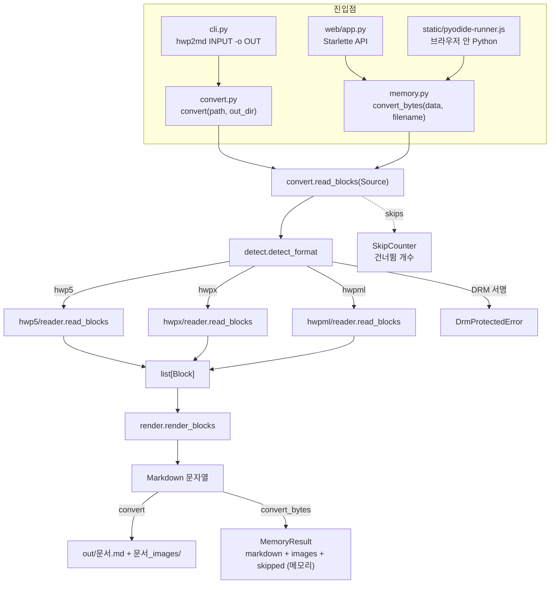
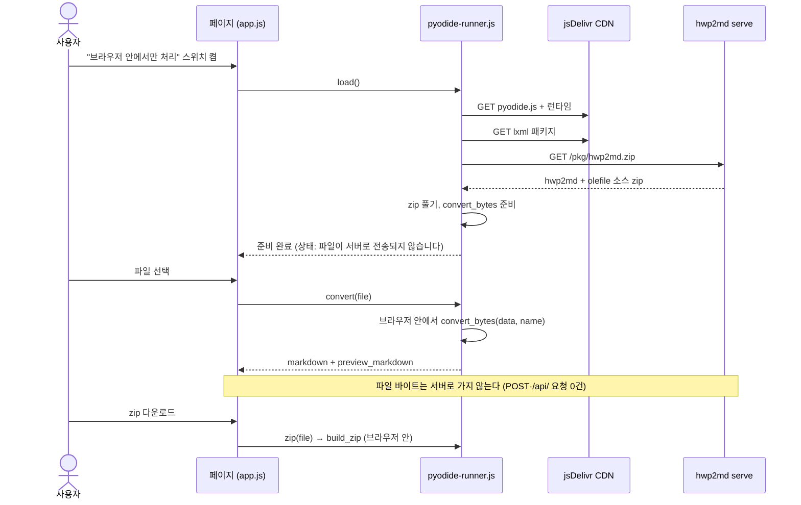

# hwp2md 시스템 개요

> 이 문서는 "어떻게 만들어져 있는가"를 적는다. 사용자가 보는 모습은 [vision.md](vision.md), 선택의 이유는 [decisions.md](decisions.md) 에 있다.

## 1. 한눈에 보기

hwp2md 는 세 층으로 나뉜다.

1. **리더** — 포맷별로 파일을 읽어 블록 리스트를 만들고, 꺼내지 못한 요소를 `SkipCounter` 에 센다 (`hwp5/`, `hwpx/`, `hwpml/`). 포맷 무관 보조 모듈(`ole.py`, `equation/`, `numbering.py`)을 함께 쓴다.
2. **블록 모델 + 렌더러** — 포맷을 모르는 `Paragraph`·`Table`·`Image`·`Note` 블록(단락 안 인라인 `Link`·`NoteRef`·`Math`·`Image`)을 Markdown 으로 바꾼다 (`blocks.py`, `render.py`).
3. **진입점** — CLI, 라이브러리 API(파일·메모리), 웹 미리보기(서버·브라우저)가 같은 리더와 렌더러를 부른다.



## 2. 모듈 지도

| 파일 | 역할 |
|---|---|
| `src/hwp2md/__init__.py` | 공개 API 재노출 (`convert`, `convert_bytes`, 블록 타입, 예외, `__version__`) |
| `src/hwp2md/cli.py` | 콘솔 진입점. `hwp2md INPUT [-o OUT_DIR]` 변환과 `hwp2md serve` 분기, 예외 → 종료 코드 |
| `src/hwp2md/convert.py` | 파일 경로 API. 포맷 감지 → 리더 → 렌더 → `.md`·이미지 파일 쓰기. 블록 개수 집계 공용 함수 |
| `src/hwp2md/memory.py` | 메모리 API. bytes → `MemoryResult`. 미리보기용 data URI 치환, zip 생성, 웹 응답 페이로드·오류 코드 매핑 |
| `src/hwp2md/source.py` | `Source = Path \| bytes` 추상화. bytes 를 `BytesIO` 로 감싸 olefile·zipfile 에 넘김 |
| `src/hwp2md/detect.py` | 내용 기반 포맷 판별 (DRM 서명 → `DrmProtectedError`, OLE → hwp5, zip + mimetype/section0 → hwpx, 루트 `<HWPML` → hwpml, 그 외 거부) |
| `src/hwp2md/blocks.py` | 블록 모델 `Paragraph(text, level, inlines, list_info)`, `Table(rows, cells)`, `Image(file_name, data)`, `Note`, 인라인 `Link`·`NoteRef`·`Math`. 정규화 함수 `make_paragraph`·`make_table` |
| `src/hwp2md/render.py` | 블록 → Markdown (제목 `#`, GFM 표, `` 링크, 링크 허용 판정 `safe_link_url`, 각주 `[^n]`, 수식 `$…$`, 목록) |
| `src/hwp2md/skips.py` | 건너뜀 종류 `SkipKind`·라벨 `SKIP_LABELS`(보고 순서)·문서별 개수 `SkipCounter` |
| `src/hwp2md/numbering.py` | 번호·글머리표 목록의 근사 번호: 번호 모양 변환, 번호 틀 채우기, 수준별 카운터 |
| `src/hwp2md/ole.py` | 세 리더 공용 OLE 처리: CFB 열기, HWPX 길이 접두 벗기기, OOXML 차트 캐시값 → 단락 + 표, `Ole10Native` 원본 그림, 그 밖은 `chart_legacy`·`ole` 보고 |
| `src/hwp2md/equation/` | 한글 수식 스크립트 → LaTeX (`to_latex`, 실패 시 `None`). `eqedit.py`·`tokens.py` 는 python-hwpx 벤더링(Apache-2.0, 출처는 루트 `NOTICE`) |
| `src/hwp2md/images.py` | 이미지 폴더 이름(`<stem>_images`), 확장자 판별(매직 바이트), `img_001` 순번 부여 |
| `src/hwp2md/errors.py` | 예외 계층 (`Hwp2mdError` → `NotHwpFileError`, `UnsupportedHwpError`(→ `DrmProtectedError`, `EncryptedDocumentError`), `EmptyInputError`, `InputTooLargeError`) |
| `src/hwp2md/hwp5/reader.py` | HWP 5.0 OLE 컨테이너: FileHeader 검사(비밀번호 → `EncryptedDocumentError`, DRM 비트 → `DrmProtectedError`), BodyText 섹션 압축 해제, 배포용 문서는 `ViewText` 섹션을 복호해 읽음 |
| `src/hwp2md/hwp5/aes.py` | 순수 파이썬 AES-128 ECB 복호 (배포용 문서 전용, 의존성 없음) |
| `src/hwp2md/hwp5/distdoc.py` | 배포용 문서 `ViewText` 스트림 복호: 배포용 문서 데이터 레코드에서 키를 만들고 나머지를 AES 로 복호 |
| `src/hwp2md/hwp5/records.py` | 레코드 스트림 파싱, PARA_TEXT(UTF-16LE + 제어 문자) 디코딩 |
| `src/hwp2md/hwp5/docinfo.py` | DocInfo: 문단 모양의 개요 수준, BIN_DATA 항목(이미지 스트림 대응) |
| `src/hwp2md/hwp5/body.py` | 레코드 level 트리 → 단락·표·그림·글상자·캡션·각주·수식·링크·목록·OLE 블록 조립. 확장 제어문자와 `CTRL_HEADER` 의 등장 순서 대응으로 단락 안 위치 복원 |
| `src/hwp2md/hwpx/reader.py` | HWPX zip 패키지: 섹션 XML 순회, 크기 상한, 보안 XML 파서 |
| `src/hwp2md/hwpx/header.py` | `header.xml` 의 `paraPr` 별 개요 수준 |
| `src/hwp2md/hwpx/bindata.py` | `content.hpf` 매니페스트 + `BinData/*` → 이미지 바이트 |
| `src/hwp2md/hwpx/body.py` | OWPML 섹션 트리 → 단락·표·그림·글상자·캡션·각주·수식·링크·목록·OLE 블록 |
| `src/hwp2md/hwpml/reader.py` | HWPML 2.x 판별(`looks_like_hwpml`: BOM·프롤로그 다음 루트 `<HWPML`), 리터럴 내부 엔티티만 치환하는 DTD 처리, 보안 XML 파서, 내장 그림·OLE 바이트 |
| `src/hwp2md/hwpml/body.py` | HWPML `BODY` 트리 → 블록. HWPX 요소와 1:1 대응이며 칸 배치·링크 해석은 `hwpx.body` 것을 재사용 |
| `src/hwp2md/web/app.py` | Starlette 앱: 변환·zip API, 정적 파일, Pyodide 용 소스 zip |
| `src/hwp2md/web/server.py` | `hwp2md serve`: 포트 확인, 브라우저 열기, uvicorn 실행 |
| `src/hwp2md/web/static/index.html` · `style.css` | 미리보기 화면 (드롭 영역, 미리보기/원문 두 칸, 모드 스위치) |
| `src/hwp2md/web/static/app.js` | 파일 선택·업로드, 미리보기 렌더(XSS 방어 렌더러), zip 다운로드, 모드 전환 |
| `src/hwp2md/web/static/pyodide-runner.js` | 브라우저 모드: Pyodide·lxml 로드, 소스 zip 풀기, `convert_bytes` 호출 |
| `src/hwp2md/web/static/vendor/` | 동봉한 Markdown 렌더러 marked (서버 모드는 CDN 없이 동작) |

## 3. 데이터 흐름

```
Source (Path | bytes)
  └─ detect_format ── DRM 서명 ────────→ DrmProtectedError (판별보다 먼저)
                   ├─ OLE ─────────────→ hwp5.reader.read_blocks(path, skips)
                   ├─ zip + mimetype ──→ hwpx.reader.read_blocks(path, skips)
                   └─ 루트 <HWPML ─────→ hwpml.reader.read_blocks(path, skips)
                                              │
                         list[Block] ◀────────┘   Block = Paragraph | Table | Image | Note
                              │                    SkipCounter → result.skipped
                              │
                    render_blocks(blocks, image_dir="<stem>_images")
                              │
                         Markdown (str, 끝에 "\n" 1개)
```

- **판별은 내용으로만 한다.** 확장자는 보지 않는다. HWPX 내용에 `.hwp` 확장자가 붙은 배포 파일이 있기 때문이다.
- **판별 순서**: ① 앞 64바이트의 DRM 서명 → `DrmProtectedError` ② OLE → hwp5 ③ zip → hwpx(아니면 거부) ④ BOM 을 건너뛴 앞부분의 루트가 `<HWPML` → hwpml ⑤ 그 외 `NotHwpFileError`.
- **HWP 5.0 리더**: OLE 컨테이너를 열고 FileHeader 속성을 확인한다. 비밀번호 비트는 `EncryptedDocumentError`, DRM 비트는 `DrmProtectedError`. 배포용 비트가 있으면 `BodyText` 대신 `ViewText` 섹션을 `distdoc`·`aes` 로 복호해 같은 경로로 읽는다. DocInfo 에서 문단 모양별 개요 수준·번호 정의와 BIN_DATA 항목을 읽고, 섹션 레코드를 level 트리로 따라가며 단락·표·그림·글상자·캡션·각주·수식·링크를 블록으로 만든다. 머리말·꼬리말은 본문에 넣지 않고 `header_footer` 로 센다.
- **HWPX 리더**: zip 안의 `Contents/section*.xml` 을 순서대로 읽는다. `hp:p` 의 텍스트·표·그림·글상자·각주·수식·링크가 블록·인라인이 되고, 머리말·꼬리말은 건너뛰며 센다. 비밀번호 문서(`META-INF/manifest.xml` 의 암호화 정보)는 `EncryptedDocumentError`. 제목 수준과 번호 정의는 `header.xml`, 그림 바이트는 `BinData/` 에서 찾는다.
- **HWPML 리더**: 단일 XML 문서를 DTD 의 리터럴 내부 엔티티만 치환한 뒤 보안 파서로 읽는다. `BODY` 의 요소를 HWPX 와 같은 규칙으로 블록으로 만들고, 내장 그림·OLE 는 문서 안의 바이너리 데이터에서 꺼낸다.
- **OLE·수식**: 세 리더는 OLE 개체를 `ole.ole_to_outcome` 에, 수식 스크립트를 `equation.to_latex` 에 넘긴다. 결과가 없으면 건너뜀으로 세거나 원문 코드 스팬으로 남긴다.
- **블록 → Markdown**: 블록 문자열 중 비어 있지 않은 것을 빈 줄로 잇는다. 표의 첫 행을 헤더로 쓰고, 병합 셀이 덮은 칸은 빈 칸, 셀 안 줄바꿈은 `<br>`. 그림은 표 칸 안 그림을 포함해 등장 순으로 `그림 N` 이라 부르고 `.md` 기준 상대 경로로 링크한다(공백은 `%20`). 링크는 http·https·mailto 만 `[글자](주소)` 로 쓰고, 각주 참조는 `[^n]`·`[^en]`, 수식은 `$…$`(변환 실패 시 코드 스팬)다.
- **건너뜀**: 리더가 `SkipCounter` 에 종류별로 센 값이 `ConvertResult.skipped`·`MemoryResult.skipped` 가 되고, CLI 는 `  건너뜀: …` 줄, 웹 페이로드는 `skipped` 배열(종류·라벨·개수)로 보여 준다. 종류별 이유는 [extraction-limits.md](extraction-limits.md).

## 4. 세 진입점

| 진입점 | 함수 | 디스크 | 결과 |
|---|---|---|---|
| CLI | `cli.main` → `convert()` | 쓴다: `<out>/<stem>.md`, 그림이 있으면 `<out>/<stem>_images/` | 요약 3줄 출력, 종료 코드 0/1/2/3 |
| 라이브러리 (파일) | `convert(path, out_dir=".")` | 쓴다 (CLI 와 동일) | `ConvertResult` (경로, 개수, markdown, 이미지 파일 목록) |
| 라이브러리 (메모리) | `convert_bytes(data, filename="document.hwp")` | 쓰지 않는다 | `MemoryResult` (markdown, `MemoryImage` 튜플, 개수) |
| 웹 서버·브라우저 모드 | `memory.convert_to_response` / `build_zip` | 쓰지 않는다 | JSON 페이로드 또는 zip 바이트 |

`convert_bytes` 의 markdown 은 `convert()` 가 쓰는 `.md` 와 바이트 단위로 같다(같은 `read_blocks` → `render_blocks` 경로). `filename` 은 이미지 폴더 이름(`<stem>_images`)을 정하는 데만 쓰이고, 경로 구분자·`..` 는 잘라낸다.

## 5. 웹 구조

`hwp2md serve` 는 `web/server.py` 가 포트를 확인한 뒤 uvicorn 으로 Starlette 앱을 띄운다. 기본 바인드 `localhost:8765`, 인증 없음.

| 메서드 | 경로 | 역할 |
|---|---|---|
| GET | `/` | 미리보기 화면 (`static/index.html`) |
| GET | `/static/...` | CSS·JS·동봉 marked |
| GET | `/api/health` | `{"ok": true, "version": "<버전>"}` |
| POST | `/api/convert?name=<파일명>` | 요청 본문(파일 바이트) → JSON: `markdown`, `preview_markdown`(그림을 data URI 로 바꾼 것), 이미지 목록, 개수 |
| POST | `/api/zip?name=<파일명>` | 요청 본문 → `<stem>.zip` (`.md` + `<stem>_images/`) |
| GET | `/pkg/hwp2md.zip` | 브라우저 모드용 소스 zip: hwp2md(web 제외) + olefile 순수 파이썬 파일 |

오류 응답은 `{"error": {"code", "message"}}` 이고 코드별 상태는 `empty` 400, `too_large` 413, `not_hwp`·`unsupported`·`drm`·`encrypted` 415, `convert_failed` 422 다. `Content-Length` 가 50MB 를 넘으면 본문을 읽지 않고 413 을 돌려준다.

### 브라우저 모드 시퀀스



서버 모드와 같은 파이썬 소스를 그대로 실어 보내므로 두 모드의 결과가 갈라지지 않는다. Pyodide 는 한 번 불러오면 페이지가 살아 있는 동안 유지되고, 로드에 실패하면 스위치가 꺼지고 서버 모드로 돌아간다. 첫 로드는 측정 약 65초다.

## 6. 보안 경계

| 경계 | 위협 | 대응 |
|---|---|---|
| 입력 파일 → 파서 | XXE(외부 엔티티), 엔티티 폭발, zip 폭탄 | lxml `XMLParser(resolve_entities=False, no_network=True, huge_tree=False)`, 섹션·이미지 엔트리 50MB 상한 |
| 손상된 바이너리 | 잘린 레코드, 깨진 zip | `Hwp2mdError` 계열 예외로 변환 실패 처리 (CLI 는 traceback 없이 종료 코드) |
| 업로드 → 서버 | 업로드 파일이 디스크에 남음 | 메모리 변환만 사용 (임시 파일 없음), 입력 50MB 상한 |
| 브라우저 모드 | 파일이 서버로 전송됨 | 변환을 브라우저 안에서 실행, 서버에는 소스 zip GET 만 |
| 변환 결과 → 미리보기 DOM | 문서에 심은 HTML·`javascript:` 링크(XSS) | 원시 HTML 은 `<br>` 만 허용, 링크는 http/https/mailto·상대 경로, 이미지는 상대 경로·`data:image/*;base64` 만 |
| 네트워크 노출 | 인증 없는 서버 | 기본 바인드 `localhost`. 외부 공개용이 아니다 |

## 7. 테스트 전략

- **합성 문서 생성기**: `tests/synth_hwp5.py` 는 명세 기준 최소 HWP 5.0(OLE + FileHeader + DocInfo + BodyText), `tests/synth_hwpx.py` 는 같은 입력 모델(`SynthHeading`·`SynthTable`·`SynthImage` …)로 HWPX 를 만든다. `tests/synth_hwpml.py`·`synth_ole.py`·`synth_distdoc.py` 는 HWPML·OLE 개체·배포용 문서를 만들고, 새 요소 입력 모델은 `tests/synth_items.py` 에 모여 있다. 두 포맷이 같은 블록·같은 Markdown 을 내는지 교차 검증한다(`tests/unit/test_cross_format.py`).
- **단위** (`tests/unit`): 레코드 파싱, PARA_TEXT 디코딩, DocInfo, 표 조립, 제목 판정, 이미지 추출, 렌더러, 포맷 판별, bytes 입력, 메모리 API, 웹 앱(Starlette TestClient).
- **E2E** (`tests/e2e`): 설치된 콘솔 스크립트를 subprocess 로 실행해 출력 파일과 표준 출력을 확인하고, 실제 `hwp2md serve` 를 띄워 HTTP API 와 Playwright(Chromium) 화면을 검증한다. 서버·브라우저·CLI 출력 동일, 브라우저 모드 무전송, 디스크 미기록, 오류 표시, zip 내용을 본다. 브라우저 모드 케이스는 인터넷이 필요하다.
- **실제 샘플**: 라이선스 확인 전이라 저장소에 넣지 않는다. `tests/fixtures/` 에 두면 E2E 가 자동으로 함께 돌린다. 요소별 샘플은 파일 이름이 아니라 `tests/samples.py` 의 구조 탐색으로 고르고, 없으면 skip 한다.
- **정적 검사**: ruff(lint·format), mypy strict.

## 8. 확장 지점

### 새 블록 타입 추가 (예: 각주 `Note` 를 넣은 방식)

1. `blocks.py` — 새 dataclass 를 만들고 `Block` 유니언에 넣는다.
2. `hwp5/body.py`, `hwpx/body.py` — 해당 레코드·요소를 새 블록으로 만든다. 블록 종류로 분기하는 곳(`isinstance`)이 새 타입을 다른 블록으로 오인하지 않는지 확인한다.
3. `render.py` — `render_blocks` 에 새 블록의 Markdown 표현을 추가한다.
4. `convert.py` `_count_blocks` / `cli.py` 요약 줄 / `memory.py` `to_payload` — 개수를 보여 주려면 함께 고친다.
5. 테스트 — `synth_hwp5.py`·`synth_hwpx.py` 에 입력 모델을 추가하고 교차 포맷 테스트로 두 리더가 같은 블록을 내는지 확인한다.

### 새 출력 옵션 (예: `--split section`, `--meta`)

블록 리스트는 이미 문서 순서와 제목 수준을 갖고 있으므로, `render_blocks` 앞에서 제목 블록 기준으로 리스트를 나누거나 블록을 세어 메타데이터를 만들면 된다. 리더는 고칠 필요가 없다.

### 새 입력 포맷

`detect.py` 에 판별 규칙과 `DocFormat` 값을 추가하고, `list[Block]` 을 돌려주는 리더를 `convert.read_blocks` 에 연결한다. 렌더러·웹·메모리 API 는 그대로 쓴다.

## 9. 관련 결정

주요 결정과 이유는 [decisions.md](decisions.md) 에 날짜순으로 있다: 스택(olefile·lxml·uv), 블록 모델, 표 렌더 규칙, 내용 기반 판별, 보안 XML 파서, 제목 판정 방식, 이미지 이름·제외 범위, 웹 프레임워크(Starlette), 메모리 변환, 브라우저 모드(Pyodide CDN + 소스 zip), 미리보기 렌더러, 그리고 2026-10-23 추출 확장(블록 모델 확장, 건너뜀 보고, 머리말·꼬리말 제외, 수식 벤더링, 배포용 문서, OLE·차트, HWPML, 보호 문서 거부, 라이선스).
