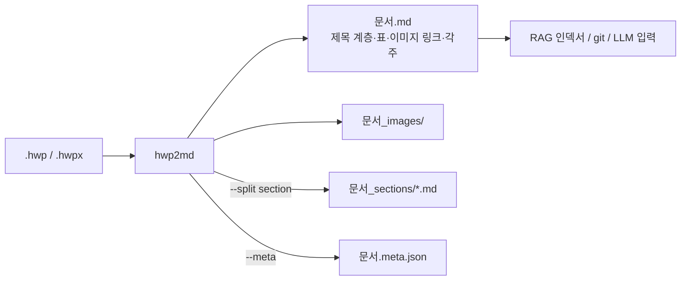

# hwp2md — 완성된 모습

> 이 문서는 "어떻게 만들까"가 아니라 "다 만들어졌을 때 사용자가 무엇을 보고 겪는가"를 적는다.
> 내부 구조는 나중에 docs/system-overview.md 와 docs/decisions.md 에서 다룬다.

## 한 문장

`pip install hwp2md` 한 줄, `hwp2md 공고문.hwp` 한 줄이면 한컴 없이 표·이미지·제목 구조가 살아 있는 Markdown이 나온다.

## 등장인물

| 역할 | 상황 | 바라는 것 |
|---|---|---|
| RAG 개발자 | 공공기관 HWP 3천 개를 지식베이스에 넣어야 한다 | 표가 깨지지 않고, 섹션 단위로 잘라 주고, 메타데이터를 같이 주면 좋겠다 |
| 데이터 분석가 | 입찰 공고 HWP에서 예산·기간 표만 뽑고 싶다 | 터미널 한 줄로 Markdown 표를 얻고 싶다 |
| 오픈소스 사용자 | 리눅스 서버, 한컴 설치 불가 | 순수 파이썬으로 돌아가야 한다 |

## 시나리오 1: 터미널 한 줄

```
$ pip install hwp2md
$ hwp2md 2026_사업공고.hwp -o out/
✓ 2026_사업공고.hwp → out/2026_사업공고.md
  제목 12개 · 표 4개 · 이미지 3개 · 각주 2개
  이미지: out/2026_사업공고_images/ (3 files)
$ tree out
out/
├── 2026_사업공고.md
└── 2026_사업공고_images/
    ├── img_001.png
    ├── img_002.png
    └── img_003.png
```

`out/2026_사업공고.md`를 열면:

```markdown
# 2026년도 OO 지원사업 공고

## 1. 사업 개요

| 구분 | 내용 |
|---|---|
| 지원 규모 | 총 30억 원 |
| 지원 기간 | 2026. 3. ~ 2026. 12. |


## 2. 신청 자격
...

[^1]: 「중소기업기본법」 제2조에 따른 중소기업
```

## 시나리오 2: RAG용 분할 + 메타데이터

```
$ hwp2md 2026_사업공고.hwp -o out/ --split section --meta
out/
├── 2026_사업공고.md
├── 2026_사업공고.meta.json
└── 2026_사업공고_sections/
    ├── 01_사업개요.md
    ├── 02_신청자격.md
    └── 03_제출서류.md
```

`meta.json`에는 문서 제목, 제목 계층(목차), 표 개수, 이미지 경로, 페이지 수, 원본 파일 해시가 들어 있어 인덱싱 파이프라인이 바로 읽는다.

## 시나리오 3: 라이브러리로

```python
from hwp2md import convert

doc = convert("2026_사업공고.hwp")
print(doc.markdown)          # 전체 Markdown
for sec in doc.sections:     # 제목 계층 기준 분할
    print(sec.title, len(sec.text))
doc.tables[0].to_markdown()  # 표 하나만
```

## 시나리오 4: HWPX도 똑같이

`hwp2md 보고서.hwpx -o out/` 입력 확장자만 다르고 출력은 동일하다. 사용자는 HWP 5.0과 HWPX의 내부 차이를 몰라도 된다.

## 결과물 비교 그림

```
  원본 HWP (한컴에서 본 모습)          hwp2md 출력 (Markdown)
 ┌────────────────────────┐          ┌────────────────────────┐
 │ 2026년도 OO 지원사업 공고 │   →      │ # 2026년도 OO 지원사업 공고│
 │                        │          │                        │
 │ 1. 사업 개요            │          │ ## 1. 사업 개요          │
 │ ┌──────┬─────────┐     │          │ | 구분 | 내용 |          │
 │ │지원규모│ 총 30억 원 │     │          │ |---|---|              │
 │ ├──────┼─────────┤     │          │ | 지원 규모 | 총 30억 원 |│
 │ │지원기간│ 3월~12월  │     │          │ | 지원 기간 | 3월~12월 | │
 │ └──────┴─────────┘     │          │                        │
 │ [그림: 추진 체계도]      │          │     │
 │ 2. 신청 자격¹           │          │ ## 2. 신청 자격[^1]      │
 │ ...                    │          │ ...                    │
 │ ¹ 중소기업기본법 제2조   │          │ [^1]: 중소기업기본법 제2조│
 └────────────────────────┘          └────────────────────────┘
```

## 흐름도



## MVP가 끝났을 때 손에 쥐는 것

- `pip install hwp2md` 로 설치되는 패키지와 CLI.
- 지원 요소 4종: 본문, 제목 계층, 표, 이미지. (각주·목차·분할 옵션은 다음)
- 공공기관 샘플 문서 20개 변환 품질 비교표 한 장.

| 문서 | 제목 보존 | 표 보존 | 이미지 추출 | 비고 |
|---|---|---|---|---|
| 공고문 A | ○ | ○ (3/3) | ○ (2/2) | |
| 보고서 B | ○ | △ (병합 셀 1개 깨짐) | ○ | 병합 셀 미지원 |
| ... | | | | |

- README의 "왜 기존 도구 대신 이것인가" 비교: 한컴 불필요, 표 보존, 이미지 위치 보존.

## "됐다"고 말할 수 있는 순간

- 한컴이 없는 리눅스 서버에서 `hwp2md` 한 줄로 20개 문서가 모두 변환된다(실패 0건, 품질은 표로 솔직하게).
- 변환된 Markdown을 그대로 GitHub에 올려 보면 표와 이미지가 눈으로 읽힌다.
- 다른 프로젝트(Korea30, 공약추적기)가 이 패키지를 import 해서 쓴다.

## 이번엔 안 만드는 것

역변환(md → hwp), 글꼴·색상 서식 재현. (README "하지 않는 것" 참조)
